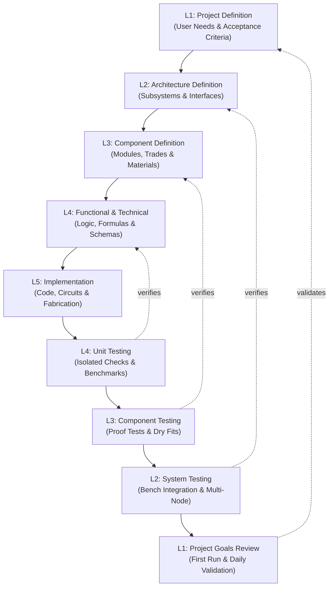

# Lightweight Development Process

A practical, scaled-down systems engineering framework designed for DIY, hobbyist, maker, and small-scale projects.

---

## Overview

Traditional systems engineering methodologies (like the classic V-Model) ensure high reliability, but enterprise versions carry immense paperwork, meeting overhead, and bureaucratic friction. Conversely, purely ad-hoc builds frequently suffer from unvetted assumptions, incompatible parts, costly tear-outs, and late-stage failures.

The **Lightweight Development Process** adapts the engineering V-Model into a minimal, practical lifecycle:
- **Every level of definition has a matching level of testing** planned upfront, not as an afterthought.
- **Requirements decompose downward** from user goals to system architecture, component boundaries, and detailed logic.
- **Verification climbs upward** from isolated unit checks and bench proof tests to full operational validation.
- **Paperwork is kept minimal**: structured templates capture only what is needed to prevent mistakes before they cost time, materials, and effort.

Whether remodeling a room, building an IoT sensor network, creating a CAD library, or fabricating workshop tools, this process provides just enough structure to keep work coherent, verifiable, and reproducible.

---

## The Lightweight V-Model

### Verification vs. Validation

- **Verification (Levels 2–4):** *"Did we build it right?"* Proves that the implementation matches the technical definitions on the test bench.
- **Validation (Level 1):** *"Did we build the right thing?"* Proves that the completed project actually solves the user's need in its real operating environment.

---

## Process Levels & Documentation Structure

The core ruleset and templates live in the [`/v_model_process`](v_model_process/) directory:

| Level | Left Side (Definition) | Right Side (Verification / Validation) | Primary Environment | Guides & Templates |
| :--- | :--- | :--- | :--- | :--- |
| **L1** | **Project Definition** Defines the problem, user scenarios, and measurable acceptance criteria. | **Project Goals Review** Validates the completed build during real-world daily operation. | Real Operating Setting (Home, field, workshop) | • [L1 Guide](v_model_process/L1%20Project/Project%20Definition%20&%20Project%20Goals%20Review.md) • [Project Definition Template](v_model_process/L1%20Project/Project%20Definition%20Template.md) • [PD-000 Master Guide](v_model_process/L1%20Project/PD-000%20Overall%20Project%20Definition.md) • [PD-000 Master Template](v_model_process/L1%20Project/PD-000%20Overall%20Project%20Definition%20Template.md) |
| **L2** | **Architecture Definition** Partitions responsibilities across subsystems, data flows, and interfaces. | **System Testing** Verifies subsystem interactions, failure modes, and NFRs on the bench. | Test Bench / Prototype Rig | • [L2 Guide](v_model_process/L2%20Architecture/Architecture%20Definition%20&%20System%20Testing.md) • [Architecture Definition Template](v_model_process/L2%20Architecture/Architecture%20Definition%20Template.md) • [Architecture Components Guide](v_model_process/L2%20Architecture/Architecture%20Components.md) • [Component Definition Sheet Template](v_model_process/L2%20Architecture/Architecture%20Component%20Definition%20Template.md) |
| **L3** | **Component Definition** Defines self-contained assemblies, trades, physical boundaries, and materials. | **Component Testing** Isolated proof testing before enclosing or integrating into the full build. | Assembly Area / Open Rough-in Space | • [L3 Guide](v_model_process/L3%20Component/Component%20Definition%20&%20Component%20Testing.md) • [Component Definition Template](v_model_process/L3%20Component/Component%20Definition%20Template.md) |
| **L4** | **Functional & Technical Definition** Specifies detailed behavior, equations, pin mappings, and schemas. | **Unit Testing** Verifies single routines, cut dimensions, or circuit sections in isolation. | Workstation / Measuring Jig / Script Runner | • [L4 Guide](v_model_process/L4L5%20Function%20Technical%20Implementation/Functional%20&%20Technical%20Definition%20&%20Unit%20Testing.md) • [Functional Definition Template](v_model_process/L4L5%20Function%20Technical%20Implementation/Functional%20Definition%20Template.md) • [Technical Definition Template](v_model_process/L4L5%20Function%20Technical%20Implementation/Technical%20Definition%20Template.md) |
| **L5** | **Implementation** Physical cutting, soldering, wiring, and code compilation at the base of the V. | — | Workbench / Tooling / IDE | • [Implementation Guide](v_model_process/L4L5%20Function%20Technical%20Implementation/Implementation.md) |

---

## Core Principles & Rules

1. **The Golden Rule of Component Work:**  
   *Never bury or enclose an unverified component behind drywall, mortar, glue, paint, or sealed housings.* Verify every section in isolation while repair access remains open.
2. **Upfront Test Design:**  
   Write test criteria when defining requirements, not after building. If a requirement cannot be tested, it is not precise enough yet.
3. **Strict Identification & Traceability:**  
   Every item across the lifecycle carries a standardized prefix ID:
   - `PD-000` / `PD-xxx`: Master Project & Project Definitions
   - `AC-n`: Observable Acceptance Criteria
   - `AD-xxx`: Architecture Definitions
   - `INT-n`: System Interactions & Data Flows
   - `FM-n`: Failure Modes & Fallback Paths
   - `NFR-n`: Non-Functional Requirements (Latency, power, memory)
   - `ST-nnn`: System Test Cases
   - `CD-xxx`: Component Definitions
   - `RESP-n`: Component Responsibilities
   - `IF-nn`: Physical & Electrical Interfaces
   - `CT-nnn`: Component Test Cases
   - `FD-xxx-n.n`: Functional Statements ("shall" clauses)
   - `TD-xxx`: Technical Definitions (Constants, mix ratios, schemas)
   - `TV-nn`: Executable Test Vectors
   - `BM-nn`: Physical Inspection Benchmarks
   - `UT-nnn`: Unit Test Cases
   - `IMP-xxx`: Implementation Records
4. **Tailoring to Project Scale:**  
   Not every change starts at the top of the V. A change enters at the highest level it affects and climbs back up through tests above that entry point. Small projects can omit unnecessary documents while retaining the core pairing.

---

## How to Use This Repository

### For DIY Builders and Makers
1. **Start with the Overview:** Read [V-Cycle for Lightweight Development.md](v_model_process/V-Cycle%20for%20Lightweight%20Development.md) to understand the workflow and tailoring principles.
2. **Define Your Goal:** Copy the [Project Definition Template](v_model_process/L1%20Project/Project%20Definition%20Template.md) (or [PD-000 Master Template](v_model_process/L1%20Project/PD-000%20Overall%20Project%20Definition%20Template.md) for multi-phase projects) into your project workspace.
3. **Decompose as Needed:** Use the L2, L3, and L4 templates according to your build's complexity. Fill out the corresponding test plans before cutting material or writing code.

### For AI Coding & Engineering Agents
Each folder in this repository contains an `AGENTS.md` context file. These files instruct LLMs and automated agents on:
- Folder boundaries and context isolation.
- Expected abstraction levels (preventing low-level pinouts in L1 or high-level goals in L4).
- Formatting, tone standards, and exact traceability patterns.

---

## License

This project is licensed under the terms specified in the [LICENSE](LICENSE) file.
