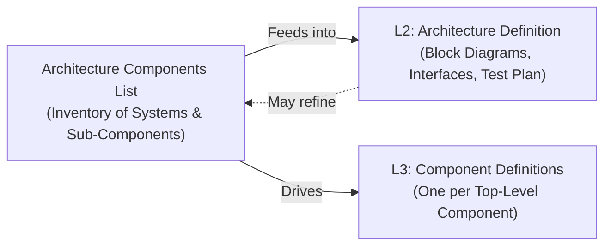
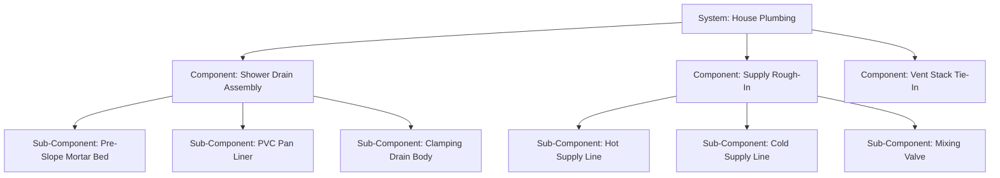
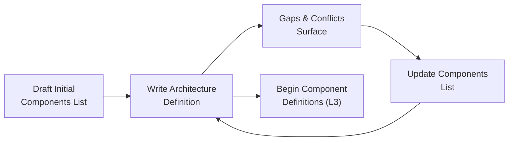

# Architecture Components

## Overview

An **Architecture Components List** is a per-project inventory of every major part (and its sub-parts) that makes up your build. It sits at Level 2 alongside the Architecture Definition and serves two roles:

1. **Direction for the Architecture Definition (L2).** The list gives the architecture author a concrete roster of systems, locations, and interfaces to organize into block diagrams, data flows, and test plans.
2. **Hints for Component Definitions (L3).** Each top-level architecture component becomes a row in the Architecture Definition's Component Decomposition table and, eventually, its own L3 Component Definition document.

The list answers a simple question early in the project: **what are all the parts, where do they live, and how do they connect?**

---

## When to Use This Document

| Situation | Recommended Format |
| --- | --- |
| Small project with fewer than 10 parts | A single table inside the Architecture Definition document (Section 4: Component Decomposition) is sufficient. No separate document needed. |
| Medium project with 10–30 parts across several systems | A standalone Architecture Components list (this document format) keeps things organized without adding weight. |
| Large or multi-phase project with many trades, systems, or subassemblies | A standalone document plus individual Architecture Component Definition sheets for complex sub-component trees. A template is provided for this case. |

---

## Architecture Component Fields

Every architecture component is described by five core fields:

| Field | What to Write | Example |
| --- | --- | --- |
| **System** | The major grouping or trade this component belongs to. Think of systems as the top-level categories of your build. | `House Plumbing`, `Electronic Packages`, `Bathroom Vanity`, `Sensor Network` |
| **Component Name** | A clear, specific name for this part. | `Shower Drain Assembly`, `Outdoor Sensor Node`, `Vanity Countertop` |
| **Location** | Where this component physically sits in the project. | `Master Bathroom — Shower Floor`, `North Patio — Exterior Wall`, `Vanity Cabinet — Upper Surface` |
| **Primary Function** | One sentence describing the main job this component performs. | `Collect and route all shower water to the waste line`, `Sample ambient temperature and transmit readings via Wi-Fi` |
| **Interfaces** | The connections where this component meets other components or external systems. Use plain language with specifics (pipe sizes, protocols, connector types). | `2-inch PVC graywater drain to house plumbing`, `MQTT over local Wi-Fi to gateway`, `3/8-inch compression fitting to supply shutoff valve` |

---

## Hierarchy: Systems, Components, and Sub-Components

Architecture components are **hierarchical**. A top-level component may decompose into sub-components, and sub-components may decompose further. This tree mirrors the way real projects break down:

### Rules for Hierarchy

1. **Only top-level components appear in the Architecture Definition's Component Decomposition table.** The Component Decomposition (Section 4 of the Architecture Definition Template) lists one row per top-level component. Sub-components do not appear there.
2. **Sub-components appear in the Component Definition's Responsibilities section.** When you write the L3 Component Definition for a top-level component, its sub-components become numbered responsibilities, interface entries, or build stages within that document.
3. **Depth is project-appropriate.** A simple shelf build may have one level. A bathroom remodel may have two or three levels. Stop decomposing when each leaf item is a single, testable piece of work.

---

## Iterative Development for New Projects

When starting a brand-new project, the architecture components list is rarely complete on the first pass. Requirements, site conditions, and material choices evolve together. The list should be **developed iteratively** to keep requirements consistent across all V-Model levels.

### Recommended Iteration Cycle

1. **Draft an initial list.** Walk through the project scope from the Project Definition (L1) and brainstorm every system and major part. Do not worry about completeness. Capture what you know.
2. **Write the Architecture Definition.** As you draw block diagrams, define interfaces, and sketch data flows, you will discover missing components, unclear boundaries, or overlapping responsibilities.
3. **Update the components list.** Add newly discovered parts, split overly broad components, merge duplicates, and refine interface descriptions. Assign or reassign system groupings.
4. **Repeat until stable.** The list stabilizes when every interface in the Architecture Definition maps to a named component on both sides and every L1 acceptance criterion traces to at least one component.
5. **Begin Component Definitions.** Once the top-level components are stable, start writing individual L3 Component Definitions. If an L3 definition reveals a missing sub-component, add it to the architecture components list and update the parent Architecture Definition if interfaces change.

> Keep a simple revision note at the bottom of the components list (e.g., "Rev 2 — added vent stack tie-in after plumbing code review"). This makes it easy to trace why a component was added or changed.

---

## Illustrative Example A: Bathroom Remodel

| System | Component Name | Location | Primary Function | Interfaces |
| --- | --- | --- | --- | --- |
| **House Plumbing** | Shower Drain Assembly | Master Bath — Shower Floor | Collect and route all shower water to waste line | 2-inch PVC graywater drain → house waste plumbing |
| **House Plumbing** | Supply Rough-In | Master Bath — Wall Cavity | Deliver hot and cold water to shower and sink fixtures | 1/2-inch PEX to mixing valve; 3/8-inch compression to sink shutoffs |
| **House Plumbing** | Vent Stack Tie-In | Master Bath — Wall Chase | Maintain proper drainage venting to prevent siphoning | 1-1/2 inch PVC sanitary tee → existing vent stack |
| **Electrical** | Lighting Circuit | Master Bath — Ceiling & Vanity | Provide switched lighting for the bathroom | 12/2 NM-B to existing panel breaker; switch leg to vanity sconce |
| **Electrical** | Exhaust Fan Circuit | Master Bath — Ceiling | Ventilate moisture from the bathroom | 14/2 NM-B to timer switch; 4-inch duct to exterior soffit vent |
| **Electrical** | GFCI Outlet Circuit | Master Bath — Vanity Wall | Supply power for personal appliances with ground-fault protection | 12/2 NM-B to GFCI receptacle; downstream feed to second outlet |
| **Shower Enclosure** | Waterproofing Pan | Master Bath — Shower Floor | Form watertight basin beneath tile | Membrane overlap to wall framing; clamping flange to drain body |
| **Shower Enclosure** | Cement Backerboard | Master Bath — Shower Walls | Provide tile substrate on shower walls | Fastened to wall framing; overlap onto waterproofing membrane |
| **Shower Enclosure** | Tile & Grout Finish | Master Bath — Shower Walls & Floor | Final waterproof surface and aesthetic finish | Thinset bond to backerboard and pan; grout joints sealed |
| **Bathroom Vanity** | Vanity Cabinet | Master Bath — South Wall | Store bathroom supplies and support countertop | Lag screws to wall studs; plumbing rough-in passes through cabinet back |
| **Bathroom Vanity** | Countertop & Sink | Master Bath — Vanity Top | Provide handwashing surface and route water to drain | P-trap to waste plumbing; faucet to supply shutoffs |
| **Finishing** | Drywall & Paint | Master Bath — Non-Wet Walls & Ceiling | Close wall cavities and provide finished surface | Taped joints to wall framing; prime and paint |
| **Finishing** | Trim & Hardware | Master Bath — Door, Base, Mirrors | Install transition strips, baseboards, towel bars, and mirrors | Finish nails or anchors to wall surface |

### Sub-Component Detail: Shower Drain Assembly

| Sub-Component | Primary Function | Interfaces |
| --- | --- | --- |
| Pre-Slope Mortar Bed | Create drainage slope under the liner | Bonded to plywood subfloor; drain body passes through center |
| PVC Pan Liner | Watertight barrier between mortar bed and tile | Overlap onto wall framing ≥ 6 in; clamped into drain body flange |
| Clamping Drain Body | Secure liner to waste pipe with compression seal | Upper flange clamps liner; lower fitting solvent-welds to 2-inch PVC waste |

---

## Illustrative Example B: Home Temperature Monitor (`PRJ-TEMP`)

| System | Component Name | Location | Primary Function | Interfaces |
| --- | --- | --- | --- | --- |
| **Sensor Network** | Outdoor Sensor Node | North Patio — Exterior Wall | Sample ambient temperature and transmit reading | MQTT publish over Wi-Fi to gateway; battery power (18650 cell) |
| **Sensor Network** | Indoor Sensor Node | Upstairs Hallway — AC Outlet | Sample indoor temperature and transmit reading | MQTT publish over Wi-Fi to gateway; USB-C mains power |
| **Gateway** | Home Automation Gateway | Server Closet — Raspberry Pi | Receive sensor data, evaluate thresholds, send alerts | MQTT subscriber on local LAN; HomeKit bridge to user phone |
| **User Interface** | Dashboard & Alerts | User Phone — HomeKit App | Display live temperatures and push notifications | HomeKit push API from gateway |
| **Infrastructure** | Home Wi-Fi Network | Local Router | Provide wireless transport between nodes and gateway | 2.4 GHz 802.11 b/g/n — existing, unchanged |

### Sub-Component Detail: Outdoor Sensor Node

| Sub-Component | Primary Function | Interfaces |
| --- | --- | --- |
| Thermistor Probe | Measure ambient temperature as analog resistance | 2-conductor shielded cable to ADC input on microcontroller |
| ESP32-C3 Microcontroller | Read sensor, compute temperature, publish MQTT payload | I2C/ADC from probe; Wi-Fi radio to home network; GPIO for battery monitor |
| Weatherproof Enclosure | Protect electronics from rain, sun, and physical damage | Mounting screws to exterior siding; cable gland for probe leads |
| Battery & Regulator | Provide regulated power for 6+ month runtime | 18650 cell to LDO regulator; voltage divider to ADC for battery monitoring |

---

## How Architecture Components Feed Other Documents

Understanding where architecture components appear — and where they do not — prevents duplication and keeps documents focused.

| Document | What Uses Architecture Components | What Does Not |
| --- | --- | --- |
| **Architecture Definition — Component Decomposition (Section 4)** | One row per **top-level component**. Copy the Component Name, Location, and Primary Function directly from this list. | Do not list sub-components here. |
| **Architecture Definition — Interactions & Data Flows (Section 5)** | Use component names and interfaces from this list to define `INT-n` interactions. | Do not define internal sub-component interactions at L2. |
| **Architecture Definition — Impact Matrix (Section 3)** | Use system groupings and change types (New / Modified / Unchanged) from this list. | Do not break the Impact Matrix down to sub-component level. |
| **Component Definition (L3)** | One document per top-level component. Sub-components become **numbered responsibilities** and **interface entries** within the Component Definition. | Do not create a separate L3 Component Definition for every sub-component unless the sub-component is large enough to warrant its own scope, test plan, and sign-off. |

---

## Simple Table Format vs. Standalone Document

For most hobby and small DIY projects, the architecture components list works best as a **single table** (like the examples above) kept inside or alongside the Architecture Definition. This avoids creating extra documents for projects with a manageable number of parts.

When a project grows large enough that individual components have complex sub-component trees, multiple trades, or need their own revision tracking, use the **Architecture Component Definition Template** to create a focused sheet per component. This template provides structured sections for sub-component breakdown, interface details, and relevant codes or standards.

### Decision Guide

| Question | If Yes | If No |
| --- | --- | --- |
| Does the component have more than 5 sub-components? | Consider a standalone Architecture Component Definition sheet. | Keep it in the table. |
| Does the component span multiple trades or disciplines? | A standalone sheet helps coordinate between trades. | The table row is sufficient. |
| Does the component need its own revision history or approval sign-off? | Use the template for formal tracking. | A table row with a revision note is fine. |

---

## Common Pitfalls

| Pitfall | Problem | Solution |
| --- | --- | --- |
| **Listing sub-components in the Architecture Definition's Component Decomposition** | The decomposition table becomes cluttered and mixes abstraction levels, making it hard to see the major pieces of the build. | Keep the Component Decomposition table to top-level components only. Sub-components belong in the L3 Component Definition. |
| **Starting the Architecture Definition without a components list** | Block diagrams and data flows are drawn from memory, leading to missing interfaces and orphaned components discovered late. | Draft the components list first, even if rough. Update it as the Architecture Definition develops. |
| **Treating the list as frozen after the first draft** | New components surface during L3 work but are never added to the master list, causing traceability gaps. | Review and update the components list whenever a new part is discovered or a boundary shifts. Note each revision. |
| **Decomposing too deeply too early** | Spending hours detailing sub-sub-components before the top-level architecture is stable wastes effort when boundaries change. | Get the top-level components stable first. Add sub-component detail only when you are ready to write the L3 Component Definition for that part. |
| **Vague interface descriptions** | Writing "connects to plumbing" instead of "2-inch PVC solvent-weld to Schedule 40 waste line" leaves ambiguity that surfaces during assembly. | Include specific sizes, thread types, protocols, or connector names in every interface field. |
