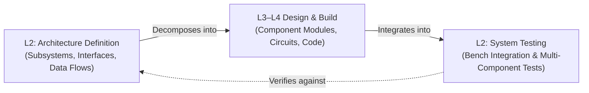
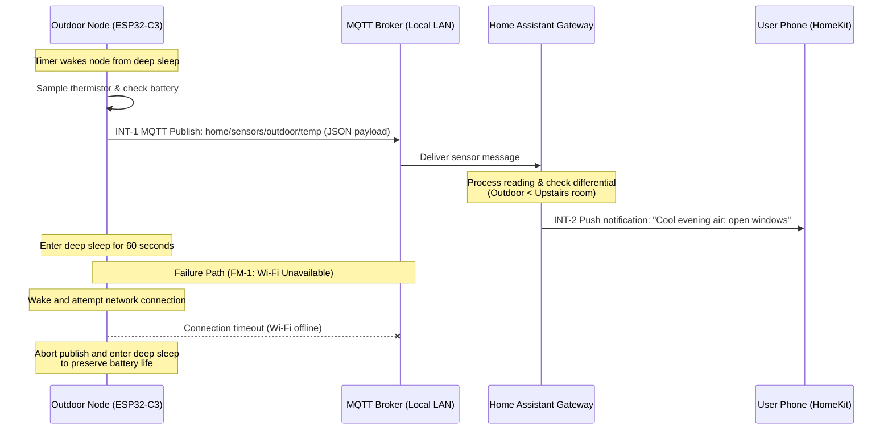

# Architecture Definition & System Testing

## Overview

Level 2 (L2) of the lightweight V-Model defines and tests how the main parts of a project connect and work together.

- The **Architecture Definition** (left side of the V) decides where responsibilities live in the system. It names the major component groups, assigns their jobs, and defines the interfaces and data flows between them. It does not define how each component works internally (that is Level 3).
- **System Testing** (right side of the V) verifies the Architecture Definition. It runs the combined subsystems together on a test bench. This proves that communications, timing, and failure modes work as designed before deployment.

Every interaction, failure mode, and constraint listed in the Architecture Definition becomes at least one test case in the System Test Plan.

## At a Glance

| Aspect | Architecture Definition (Left Side) | System Testing (Right Side) |
| --- | --- | --- |
| **Core Question** | How do the project parts fit together, and how do they communicate? | Do the combined modules work together correctly on the test bench? |
| **Perspective** | The complete system: microcontrollers, sensors, wiring, network, and displays | Same |
| **Primary Inputs** | Parent Project Definition (`PD-001` or `PRJ-TEMP`) and Early Technical Notes | System Test Plan from the Architecture Definition |
| **Conducted By** | Project builder or lead designer before detailed module design | Project builder testing integrated hardware on the bench |
| **Operating Setting** | Design notebook, block diagrams, or repository documentation | Workbench test rig, prototype hardware, and local test network |

---

## Part 1: Architecture Definition (Left Side)

### Purpose

The Architecture Definition answers **where** each function lives in your build. It breaks the project into distinct component groups, sets their boundaries, and specifies the contracts between them.

For example, in a multi-board or networked build, the architecture decides which microcontroller reads a sensor. It decides which device computes formulas. It also defines how messages travel across Wi-Fi or serial lines.

### System Context & The Impact Matrix

Begin every Architecture Definition by sketching the system boundary and identifying all touched components.

The **Impact Matrix** lists every subsystem affected by the project. It shows reviewers and builders what is new, what is modified, and what existing equipment remains untouched.

#### Illustrative Example: Home Temperature Monitor (`PRJ-TEMP`)

| Component Group | Physical / Logical Location | Change Type | Interfaces Affected |
| --- | --- | --- | --- |
| **Outdoor Sensor Node** | North Patio / Weatherproof Enclosure | New: battery-powered sensing node | Wi-Fi / MQTT Telemetry (new) |
| **Indoor Sensor Node** | Upstairs Hallway / AC Power | New: mains-powered sensing node | Wi-Fi / MQTT Telemetry (new) |
| **Home Automation Gateway** | Local Server (Raspberry Pi / Home Assistant) | Modified: sensor entities and alert logic | MQTT Broker, HomeKit bridge |
| **User Dashboard** | Mobile App / Smart-Home Screen | Modified: displays live temperature tiles | HomeKit / Dashboard UI |
| **Home Wi-Fi Network** | Local Network Router | Unchanged: existing 2.4 GHz IoT SSID | Standard 802.11 b/g/n traffic |

### What Belongs in the Architecture Definition

| Section | What to Write | Practical Guidance |
| --- | --- | --- |
| **Architecture Overview** | Summary of the system layout and which Project Definition it satisfies. | Link directly to the parent `PD-001` document. |
| **System Context & Boundaries** | A block diagram showing what is inside this build versus external systems. | Highlight the boundary between your project and third-party systems. |
| **Component Decomposition** | Table of major components, where each lives, its primary job, and covered L1 requirements. | Each row becomes a Level 3 Component Definition. |
| **Impact Matrix** | Table of component groups marked as New, Modified, or Unchanged. | Include unchanged external systems so reviewers know they were evaluated. |
| **Interactions & Data Flows** | How components exchange data, including message topics, payloads, and sequence diagrams. | Assign each interaction an ID (`INT-1`, `INT-2`) and include failure paths. |
| **Key Interfaces** | Connectors, voltage levels, pin protocols (I2C, SPI, UART), and network data schemas. | Specify pinouts, logic levels (3.3V vs 5V), and JSON keys. |
| **Architectural Constraints** | Power budgets, memory limits, bus speeds, sleep timing, and thermal limits. | Address non-negotiable hardware boundaries. |
| **Non-Functional Requirements** | Quantified latency, battery life, update rates, and reliability targets. | Derive each from an L1 criterion and give it an ID (`NFR-1`). |
| **Failure Modes & Degradation** | What each component does when a sensor disconnects, power drops, or the network fails. | Give each failure mode an ID (`FM-1`, `FM-2`). |
| **System Test Plan** | Test bench setup and test cases verifying every `INT`, `FM`, and `NFR` ID. | Written during architecture design, not after coding. |
| **Traceability** | Links to parent project goals and child component modules. | Maintain clean upstream and downstream links. |

### What Does Not Belong Here

Keep detailed implementation out of Level 2:
- Do not restate user personas or high-level problem statements (these belong in L1 Project Definition).
- Do not write internal algorithm code, private helper functions, or state machines (these belong in L3 Component Definition and L4 Functional Definition).
- Do not list pinouts, circuit wiring schematics, or register bitmasks (these belong in L3/L4 Technical Definition).

> If specific component or circuit ideas occur while drafting the architecture, record them in an "Early Component Notes" appendix for the Level 3 authors.

### Defining Architectural Constraints

Architectural constraints are the non-negotiable physical and operational limits of your project. They define the boundaries that every part of your build must follow.

Unlike component details (such as pin choices or code loops), architectural constraints apply across the whole system. They ensure that hardware nodes, power supplies, and network links work together safely.

Evaluate constraints across five core system categories:

| Constraint Category | What It Governs | Home Temperature Monitor Example (`PRJ-TEMP`) |
| --- | --- | --- |
| **Power & Energy Envelope** | Power distribution, battery capacity, and current limits across nodes. | The outdoor node must operate for at least 6 months on a single 18650 cell. Active wake current cannot exceed 300 mA, and deep sleep current must remain under 25 microamps. |
| **Communication & Topology** | Physical transmission layer, radio protocols, bandwidth limits, and reach. | Uses existing 2.4 GHz home Wi-Fi and local MQTT. Transmissions are limited to one 128-byte JSON payload every 60 seconds per node. System operates locally with no cloud dependency. |
| **Failure Isolation** | Independent operation when network links, brokers, or peer devices fail. | A dropped Wi-Fi link or offline broker must never lock up a sensor node. The node must abort transmission after 5 seconds and enter deep sleep to preserve battery life. |
| **Boot Independence** | Uncoordinated startup sequencing across distributed devices. | Nodes, the MQTT broker, and Home Assistant power on in random order. Sensor nodes must retry connection gracefully if the broker is not yet online. |
| **Physical & Environmental** | Spatial boundaries, mounting constraints, weather exposure, and temperature limits. | The outdoor node must fit within a compact weatherproof enclosure (IP65 rated or shielded) and operate reliably from -10 °C to 45 °C in direct outdoor conditions. |

### Interaction, Failure Mode, and NFR IDs

Assigning systematic IDs makes testing straightforward:
- **`INT-n`**: System Interactions (e.g., `INT-1: Outdoor Node publishes temperature JSON to MQTT broker`).
- **`FM-n`**: Failure Modes (e.g., `FM-1: Wi-Fi connection timeout triggers deep sleep fallback`).
- **`NFR-n`**: Non-Functional Requirements (e.g., `NFR-1: Total active wake duration is under 3 seconds`).

Every System Test case references these IDs to prove complete test coverage.

### Writing Good Non-Functional Requirements

Non-functional requirements must be **numeric**, **testable**, and **traceable** to a Level 1 acceptance criterion.

| Weak Requirement | Strong Requirement |
| --- | --- |
| "Sensor updates should be fast." | **NFR-1:** The outdoor node wakes, samples the sensor, and publishes an MQTT message within 2.5 seconds. (Derived from L1 battery and update criteria). |
| "Do not flood the network." | **NFR-2:** Periodic telemetry publishes at most once every 60 seconds; payload size does not exceed 128 bytes. |
| "Memory usage should stay low." | **NFR-3:** Free heap on the sensor node remains stable within ±2 KB across 48 hours of continuous operation with zero memory leaks. |
| "Handle loss of Wi-Fi." | **FM-1:** If Wi-Fi fails to connect within 5 seconds, the node aborts transmission, logs the error, and enters deep sleep for 60 seconds without locking up. |
| "Handle bad sensor readings." | **FM-2:** If a sensor probe is disconnected or shorted, the node transmits a null reading with an error flag rather than sending an incorrect zero value. |

### Illustrative Data Flow & Sequence Diagram

---

## Part 2: System Testing (Right Side)

### Purpose

System Testing **verifies the Architecture Definition**. It tests the combined hardware modules, wiring, communication links, and server gateways together on the test bench.

While Level 3 and Level 4 tests verify individual code routines and circuit blocks, System Testing verifies the seams. It checks message formats, communication timeouts, power transitions, and fault recovery.

Write the System Test Plan during the architecture phase. This ensures that test criteria are established before building begins.

### Test Bench Environment

- Prototype hardware modules assembled on the workbench with target wiring, power supplies, and antennas.
- A functional local network with the actual MQTT broker and home automation platform.
- Diagnostic monitoring: serial monitor connections, MQTT client monitors, and a multimeter or current probe to measure power draw.
- Physical access to induce faults: disconnecting sensor leads, switching off network power, and simulating low battery voltages.

### Entry Criteria

Before beginning System Testing, verify these prerequisites:
- [ ] Architecture Definition completed and approved, including the System Test Plan.
- [ ] All child Component Definitions (L3) have passed Component Testing on the bench.
- [ ] Microcontrollers flashed with current baseline firmware.
- [ ] Workbench wiring, power supplies, and test instrumentation ready.
- [ ] Diagnostic tools (serial monitor, network packet viewer) active.

### Exit Criteria

System Testing concludes successfully when:
- [ ] Every interaction (`INT`) has at least one passing test case.
- [ ] Every failure mode (`FM`) has been deliberately induced and behaves as specified.
- [ ] Every non-functional requirement (`NFR`) is measured and meets its numeric target.
- [ ] Continuous bench stability run passes with zero unplanned restarts or memory leaks.
- [ ] Recovery procedures (firmware reflashing and config restoration) are verified.

### What System Testing Covers

| Testing Category | What Is Tested | Reference Section |
| --- | --- | --- |
| **End-to-End Data Flows** | Verifies that a physical sensor change travels through the node, broker, and gateway to the screen. | System Interactions (`INT`) |
| **Interface Contracts** | Confirms that JSON payloads, topic names, and pin voltage levels match technical specifications. | Key Interfaces |
| **Timing & Latency** | Measures wake-up duration, sensor sampling speed, and notification delivery delays. | Non-Functional Requirements (`NFR`) |
| **Failure Modes & Recovery** | Induces disconnected leads, router power-offs, and broker crashes to verify safe fallback and self-recovery. | Failure Modes (`FM`) |
| **Boot Order Independence** | Powers on subsystems in random sequence to confirm clean connection recovery. | Architectural Constraints: Boot Ordering |
| **Power Consumption** | Measures active current spikes and sleep current to validate battery life projections. | Architectural Constraints: Power Budget |
| **Long-Term Stability** | Runs continuous multi-hour bench cycles to detect memory leaks, counter rollovers, or lockups. | Non-Functional Requirements (`NFR`) |

---

## Common Pitfalls

| Pitfall | Problem | Solution |
| --- | --- | --- |
| **Only testing the happy path** | Real-world builds fail when network or hardware hiccups occur. | Design every sequence diagram with an explicit failure path (`FM`) and test it on the bench. |
| **Unclear ownership of state** | Two nodes attempt to make conflicting decisions or calculate the same values. | Assign clear ownership: exactly one component owns each measurement or control decision. |
| **Neglecting power current spikes** | Wi-Fi transmit bursts cause brownout resets on weak batteries or undersized regulators. | Measure peak current during radio transmit using a multimeter or scope on the bench. |
| **Untested recovery from network drop** | A temporary Wi-Fi drop leaves a node frozen in a retry loop until the battery dies. | Test network recovery by turning off the router and observing node sleep and reconnect behavior. |
| **Writing test cases after building** | Tests become biased toward what was built rather than what was required. | Write the System Test Plan alongside the Architecture Definition before starting detailed implementation. |

### Illustrative Test Case

| Test Field | Value |
| --- | --- |
| **Test Case ID** | `ST-TEMP-003` |
| **Verifies** | Architecture Definition: Sensor Network & Telemetry, Failure Mode `FM-1` (Wi-Fi Disconnect Fallback) |
| **Setup** | Prototype Outdoor Node connected to workbench battery supply and serial monitor; Wi-Fi router on a switched outlet. |
| **Test Procedure** | 1. Confirm regular 60-second wake and publish cycles. 2. Switch off power to the Wi-Fi router while the node is asleep. 3. Observe node behavior upon waking. 4. Verify the node attempts connection for at most 5 seconds, logs a network timeout, and enters deep sleep. 5. Switch router power back on. 6. Observe the next wake cycle. |
| **Expected Result** | The node does not freeze or stay awake continuously. Wake duration during network failure is under 6 seconds. Sleep current drops to under 25 microamps. On the next wake cycle with Wi-Fi restored, the node reconnects and publishes normally. |
| **Evidence Captured** | Serial monitor log with timestamps; bench current measurement showing sleep current drop. |
