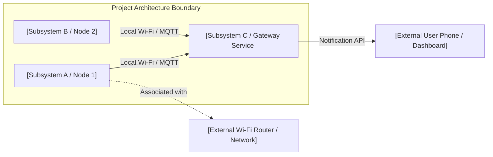
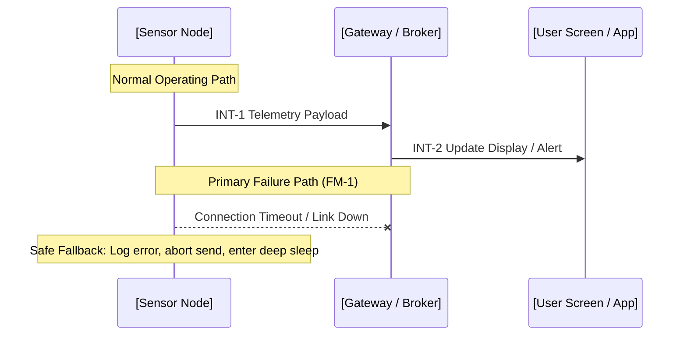

# Architecture Definition Template

*Use this template to define the system architecture at Level 2 (L2) of the lightweight V-Model. The Architecture Definition decides where each job lives, how component groups share data, and how failure modes are handled. It sets the contracts that System Testing checks on the test bench before deployment.*

---

# [System Architecture Title]

- **Document ID:** AD-[XXX] (e.g., `AD-001` or `AD-TEMP`)
- **Parent Project Definition:** [PD-XXX: Project Definition Name]
- **Author / Builder:** [Name]
- **Status:** [Draft | In Review | In Progress | In System Testing | Complete]
- **Target Date:** [YYYY-MM-DD]

---

## 1. Architecture Overview

*Provide a high-level summary of the system architecture. Explain what this architecture does, how major parts fit together, and which Level 1 Project Definition it satisfies.*

- **System Purpose:** [Summarize what this architecture does in 2–3 sentences.]
- **Core Approach:** [Describe the high-level physical and logical approach, e.g., battery-powered sensor nodes publishing local MQTT messages to a home gateway.]

---

## 2. System Context & Boundaries

*Define what is inside the project boundary versus external systems. Use a block diagram to show all major subsystems and external interfaces.*

- **Inside the Boundary:** [List hardware modules, firmware images, and custom software designed in this project.]
- **Outside the Boundary (External Systems):** [List external routers, third-party apps, cloud services, or existing building utilities.]

---

## 3. Impact Matrix

*Identify every subsystem and component group touched by this architecture. Include unchanged hardware and networks so reviewers see they were evaluated.*

| Component Group | Physical / Logical Location | Change Type | Interfaces Affected |
| --- | --- | --- | --- |
| **[Subsystem 1]** | [Physical location, e.g., Patio enclosure] | [New / Modified / Unchanged] | [e.g., Wi-Fi telemetry, battery sensor] |
| **[Subsystem 2]** | [Physical location, e.g., Upstairs hallway] | [New / Modified / Unchanged] | [e.g., Local display, mains power] |
| **[Gateway / Backend]** | [Physical location, e.g., Local server] | [New / Modified / Unchanged] | [e.g., MQTT broker, mobile push service] |
| **[Network Infrastructure]** | [Physical location, e.g., Home router] | [Unchanged] | [Standard 2.4 GHz traffic] |

---

## 4. Component Decomposition (Child L3 Components)

*Break down the architecture into distinct components. Each row in this table will become a Level 3 (L3) Component Definition with its own focused scope.*

| Component ID | Component Name | Location | Primary Responsibility | Covered L1 Criteria |
| --- | --- | --- | --- | --- |
| **CD-001** | [Component 1 Name] | [Node or Board] | [Primary function, e.g., Sample sensor & read battery] | [AC-1, AC-2] |
| **CD-002** | [Component 2 Name] | [Node or Board] | [Primary function, e.g., Manage sleep cycles & Wi-Fi transmission] | [AC-3, AC-4] |
| **CD-003** | [Component 3 Name] | [Gateway / Server] | [Primary function, e.g., Ingest MQTT, evaluate differential, send alert] | [AC-1, AC-5] |

---

## 5. System Interactions & Data Flows

*Define how components communicate across the architecture. Give each interaction a unique ID (INT-n) and detail the source, destination, protocol, and payload.*

| Interaction ID | Source | Destination | Protocol / Medium | Payload / Data Summary | Frequency / Trigger |
| --- | --- | --- | --- | --- | --- |
| **INT-1** | [Component 1] | [Component 2] | [e.g., MQTT / Wi-Fi] | [JSON temperature and battery payload] | [Periodic, e.g., every 60 s] |
| **INT-2** | [Component 2] | [User Screen] | [e.g., Push Notification] | [Alert text: outdoor cooler than indoor] | [Event-driven, threshold met] |

### Sequence Diagram
*Include both the normal operating path (happy path) and the primary failure path.*

---

## 6. Key Interfaces & Physical Connections

*Specify connectors, voltage levels, bus types, and data formats at subsystem boundaries.*

- **Wired Buses & Connectors:** [e.g., I2C bus on 3.3V logic, JST-XH 4-pin connector, screw terminal for 5V DC.]
- **Wireless Protocols:** [e.g., 2.4 GHz Wi-Fi (802.11b/g/n), local MQTT over port 1883 with basic authentication.]
- **Data Schemas & Formats:** [e.g., JSON payload: `{"temp_c": 21.4, "battery_v": 3.82, "uptime_s": 120}`.]

---

## 7. Architectural Constraints

*Define the non-negotiable physical and operating limits of the complete system.*

| Constraint Category | What It Governs | Architecture Limits & Targets |
| --- | --- | --- |
| **Power & Energy Envelope** | Power sources, battery lifespan goals, peak and sleep current. | [e.g., Battery node must run >= 6 months on single cell; active peak <= 300 mA; sleep <= 25 uA.] |
| **Communication & Topology** | Radio frequency, packet size, bandwidth, and local vs. cloud limits. | [e.g., Local 2.4 GHz Wi-Fi only; payload <= 128 bytes; zero cloud dependency.] |
| **Failure Isolation** | Autonomous operation when peer nodes, brokers, or networks fail. | [e.g., Loss of Wi-Fi must never freeze the microcontroller; abort after 5 s and sleep.] |
| **Boot Independence** | Uncoordinated startup sequencing across distributed devices. | [e.g., Nodes and broker boot in arbitrary order; nodes retry without locking up.] |
| **Physical & Environmental** | Size limits, mounting constraints, weatherproofing, and temperature range. | [e.g., Outdoor box must be weatherproof (IP65) and run from -10 C to 45 C.] |

---

## 8. Non-Functional Requirements (NFRs)

*List numeric, testable requirements derived from Level 1 acceptance criteria. Every requirement is checked during System Testing.*

| NFR ID | Derived L1 Goal | Metric & Numeric Target | Verification Method |
| --- | --- | --- | --- |
| **NFR-1** | [AC-1: Fast updates] | [e.g., Total wake-to-publish latency <= 2.5 seconds] | [Bench timer / serial log capture] |
| **NFR-2** | [AC-3: Network load] | [e.g., Telemetry packet rate <= 1 message per 60 seconds; size <= 128 bytes] | [Network monitor / MQTT client viewer] |
| **NFR-3** | [AC-4: Reliability] | [e.g., Free heap memory stable within +-2 KB over 48 hours continuous run] | [Serial memory logging over 48 h] |

---

## 9. Failure Modes & Degraded Behavior

*Identify how the system handles faults and unexpected conditions. Give each failure mode an ID (FM-n).*

| Failure ID | Fault Condition | Expected System Behavior | Self-Recovery Mechanism |
| --- | --- | --- | --- |
| **FM-1** | [Wi-Fi connection drop or broker offline] | [Abort publish after 5 s timeout; enter sleep; preserve battery] | [Retry connection on next scheduled wake cycle] |
| **FM-2** | [Sensor probe disconnected or wire damaged] | [Transmit null value with error flag; do not send false zero] | [Resume normal readings when probe is reconnected] |
| **FM-3** | [Low battery voltage threshold reached] | [Send low-battery alert flag; increase sleep interval to 5 min] | [Normal operation restores after battery recharge] |

---

## 10. System Test Plan (Right Side of the V)

*Outline the test bench plan. Every interaction, failure mode, and requirement ID must be checked on test hardware before deployment.*

### Test Bench Environment Setup
- **Hardware on Bench:** [Prototype microcontroller nodes, target sensors, breadboard or prototype wiring, test power supply.]
- **Network & Diagnostics:** [Local Wi-Fi router on switched outlet, local MQTT broker, serial logging terminals, multimeter or power meter.]

### Entry Criteria
- [ ] Architecture Definition completed and reviewed.
- [ ] Child Component Definitions (L3) completed and verified in component bench tests.
- [ ] Baseline firmware flashed to prototype hardware.
- [ ] Test bench instrumentation (serial monitors, current meters) connected.

### Exit Criteria
- [ ] Every interaction (INT-1, INT-2) verified on the bench.
- [ ] Every failure mode (FM-1, FM-2, FM-3) deliberately induced and observed.
- [ ] Every non-functional requirement (NFR-1, NFR-2, NFR-3) measured and passed.
- [ ] Multi-hour bench stability run completed with zero unplanned restarts.

### System Test Cases

| Test ID | Verifies (INT / FM / NFR) | Test Procedure Summary | Expected Result | Pass / Fail |
| --- | --- | --- | --- | --- |
| **ST-001** | [INT-1, NFR-1] | [Trigger node wake; measure time until MQTT message arrives at broker.] | [Message received within 2.5 s with correct JSON structure.] | [ ] |
| **ST-002** | [FM-1] | [Power off Wi-Fi router; observe node behavior upon waking.] | [Node attempts connection for <= 5 s, logs timeout, enters deep sleep.] | [ ] |
| **ST-003** | [FM-2] | [Disconnect probe wire while node is running.] | [Node publishes error payload; interface flags sensor fault.] | [ ] |
| **ST-004** | [NFR-3] | [Run system continuously on test bench for 48 hours; log heap memory.] | [Free heap remains within +-2 KB of baseline with zero reboots.] | [ ] |

---

## 11. Early Component Notes (Scratchpad for L3 Component Definition)

*Do not put low-level coding details, register settings, or circuit schematics in the architecture sections above. Record early component ideas here for the Level 3 phase.*

- *Candidate Components & Pinouts:* [e.g., ESP32-C3 SuperMini; I2C on SDA GPIO 8 / SCL GPIO 9; ADC voltage divider on GPIO 0.]
- *Library & Algorithm Thoughts:* [e.g., Use Adafruit BME280 library or raw I2C read; use moving average filter over 5 samples.]
- *Power Circuit Notes:* [e.g., Low-quiescent LDO (e.g., ME6211) or direct 1S LiFePO4 feed; bypass capacitor 10 uF on sensor rail.]

