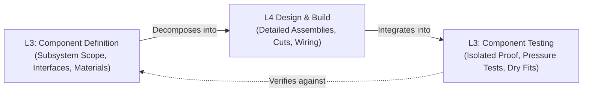

# Component Definition & Component Testing

## Overview

Level 3 (L3) of the lightweight V-Model defines and tests the individual components, subsystems, or physical trades that make up your project.

In a DIY, hobby, or home project, a "component" is not just code or electronics. A component is any distinct, self-contained part of your project with clear boundaries and connections:
- In a **bathroom remodel**, components include the plumbing rough-in, electrical wiring, subfloor, shower waterproofing pan, vanity, and ventilation fan.
- In a **workshop build**, components include the welded frame, worktop surface, linear guide rails, and dust collection piping.
- In a **maker or electronics project**, components include the sensor probe, microcontroller board, power regulator, and custom enclosure.

The **Component Definition** on the left side of the V defines what one specific part owns, how it connects to surrounding parts, and what criteria it must meet before assembly.

**Component Testing** on the right side of the V tests that component in isolation before you integrate it into the full build.

The golden rule of Level 3 is simple: **Never bury an unverified component behind drywall, glue, paint, or closed enclosures.** Catching mistakes in one part early is fast and cheap. Fixing mistakes after full assembly is costly and painful.

## At a Glance

| Aspect | Component Definition (Left Side) | Component Testing (Right Side) |
| --- | --- | --- |
| **Core Question** | What does this specific component own, and how does it connect to the build? | Does this component pass inspection and proof testing on its own before installation? |
| **Perspective** | A single subsystem, physical assembly, or trade treated as a self-contained unit | Same |
| **Primary Inputs** | Parent Architecture Definition (`AD-001`) and assigned component scope | Component Test Plan from the Component Definition |
| **Conducted By** | The builder or trade lead planning that specific section | The builder inspecting and proof-testing the isolated section |
| **Operating Setting** | Project notes, trade drawings, or component specifications | Workbench, assembly jig, or open rough-in space before closing walls or cases |

---

## Part 1: Component Definition (Left Side)

### Purpose

The Component Definition explains **how one component does its work** as assigned by the parent Architecture Definition. It sets responsibilities, interfaces, material requirements, and installation rules clearly enough to build and test the part in isolation.

Detailed step-by-step cut lists, wire color tables, and register settings belong in child Functional and Technical Definitions (Level 4).

### What Belongs in the Component Definition

| Section | What to Write | Practical Guidance |
| --- | --- | --- |
| **Component Overview** | Brief summary of what this component is and why it exists as a separate piece. | One paragraph. Link directly to the parent Architecture Definition. |
| **Physical Location & Boundaries** | Where this component sits physically (room zone, mounting location, or enclosure). | Define clear boundaries where this component starts and stops. |
| **Responsibilities & Performance** | Numbered list of functions, standards, or structural loads this component must satisfy. | Be specific: "Maintain 1/4 inch per foot slope," "Hold 60 PSI without leaking." |
| **Interfaces & Connections** | Every physical joint, pipe fitting, electrical terminal, or data line crossing the boundary. | Always include dimensions, thread types (e.g., 1/2-inch NPT), and ratings. |
| **Materials & Specifications** | Specific lumber grades, pipe schedules, wire gauges, or hardware breakout boards. | List exact grades (e.g., Schedule 40 PVC, 12/2 NM-B wire, marine plywood). |
| **Installation Rules & Tolerances** | Critical assembly rules, fastener spacing, torque specs, slope, or cure times. | Document non-negotiable building codes or assembly limits. |
| **Safety & Hazard Precautions** | Safety risks specific to this module (water shutoff, electrical breaker lockouts, fumes, dust). | Identify precautions needed during assembly and testing. |

### What Does Not Belong Here

Keep low-level details out of Level 3:
- Do not restate high-level project goals or total budgets (belongs in L1 Project Definition).
- Do not write whole-house wiring plans or multi-room layouts (belongs in L2 Architecture Definition).
- Do not list tiny fastener counts or detailed line-by-line cut lists (belongs in L4 Technical Definition).

### Component Lifecycle & Operating Modes

For physical assemblies, a component moves through distinct build stages:
- **`ROUGH-IN`**: Initial framing, pipe running, or circuit board assembly.
- **`INSPECTION & TEST`**: Isolated pressure test, flood test, electrical check, or bench calibration.
- **`ENCLOSED`**: Backerboard hung, drywall finished, or housing sealed after passing testing.
- **`TRIM & FINISH`**: Fixtures mounted, faceplates installed, or final surface coats applied.

For electronics or software modules, components move through operational states (such as `BOOT`, `SAMPLE`, `TRANSMIT`, `SLEEP`, or `FAULT`).

---

## Part 2: Component Testing (Right Side)

### Purpose

Component Testing **verifies the Component Definition**. It tests one component by itself before you connect it to the rest of the project or cover it up.

Testing each component in isolation ensures that when you assemble the complete system, you know every individual part already works.

### Common Flavors of Component Testing across DIY Projects

Choose the testing method that matches your component type:

| Testing Method | Practical Application | Why It Matters |
| --- | --- | --- |
| **Pressure & Watertightness Tests** | Flood-testing a shower pan for 24 hours; pressure-testing plumbing supply pipes at 60 PSI before closing walls. | Catches catastrophic water leaks when repairs take minutes instead of thousands of dollars in tear-outs. |
| **Electrical Continuity & Safety Checks** | Checking circuit continuity with a multimeter; testing GFCI trip function before installing drywall. | Confirms zero wiring shorts and correct polarity before live power is connected. |
| **Dimensional, Level & Square Checks** | Measuring diagonals (3-4-5 rule) on frames; checking subfloor flatness with a 6-foot level; verifying drain slope. | Prevents crooked tile, rocking vanities, binding drawers, or pooling water. |
| **Dry-Fit Checks** | Test-fitting PVC pipes, cabinet face frames, or mechanical brackets without glue or permanent fasteners. | Confirms proper clearance, alignment, and insertion depth before making irreversible bonds. |
| **Bench & Mock Testing (Electronics)** | Testing a sensor board on the workbench with a potentiometer and bench power supply before field mounting. | Proves that circuits read signals and handle power changes before outdoor installation. |

### Entry Criteria

Before starting Component Testing, verify these items:
- [ ] Component rough-in or assembly is complete to the test boundary.
- [ ] Test fittings, pressure gauges, mechanical drain plugs, or test meters are attached.
- [ ] Surrounding areas are protected (e.g., towels ready, power locked out at breaker).

### Exit Criteria

Component Testing is complete when:
- [ ] Every stated responsibility has passed its physical proof test or inspection.
- [ ] Zero leaks, pressure drops, or electrical shorts are observed over the test period.
- [ ] All dimensions, slope angles, and levels fall within stated tolerances.
- [ ] Test results are recorded before covering the component.

---

## Two Illustrative Examples

### Example A: Physical Home Improvement (Bathroom Remodel)

> **Component Definition: Shower Waterproofing Pan (`CD-004`)**
>
> **Parent Architecture:** Master Bathroom Remodel Architecture (`AD-001`)  
> **Physical Location:** Master bathroom shower floor area (36-inch by 48-inch footprint).
>
> **Responsibilities:**
> 1. Form a 100% watertight basin to contain daily shower water.
> 2. Direct all water to the 2-inch central drain with a minimum slope of 1/4 inch per foot.
> 3. Extend waterproof barrier at least 6 inches up all surrounding wall framing and over the curb.
> 4. Provide a sound, deflection-free bonding surface for floor tile.
>
> **Interfaces & Connections:**
>
> | Interface | Direction / Type | Details & Ratings | Connects To |
> | --- | --- | --- | --- |
> | Central Drain Body | Mechanical clamping flange | 2-inch Schedule 40 PVC clamping drain | Household waste plumbing |
> | Wall Framing Overlap | Physical joint | Waterproof membrane extends >= 6 inches up studs | Cement backerboard |
> | Shower Curb | Physical boundary | Fully wrapped membrane over wood or mortar curb | Bathroom subfloor interface |
>
> **Materials:** Clamping shower drain, 40-mil PVC pan liner (or bonded waterproof membrane), pre-slope mortar bed, silicone sealant.
>
> **Installation Rules:** Pre-slope must be minimum 1/4 inch per foot; pan liner must not be pierced by fasteners below 3 inches above the curb top.

#### Component Test Case: 24-Hour Standing Water Flood Test

| Field | Record Details |
| --- | --- |
| **Test ID** | `CT-SHOWER-001` |
| **Verifies** | Shower Waterproofing Pan (`CD-004`), Responsibility 1 (100% Watertight Basin) |
| **Setup** | Insert mechanical expansion plug into the 2-inch drain outlet. Fill the pan with clean water to 1/2 inch below the top of the curb. Mark water line with tape. |
| **Test Procedure** | 1. Leave standing water in the pan for 24 continuous hours. 2. Inspect water level at 12 hours and 24 hours. 3. Inspect the subfloor and ceiling below the shower for any signs of moisture or weeping. |
| **Expected Result** | Zero drop in water level over 24 hours (excluding minor evaporation under 1/16 inch). Zero dampness on subfloor or framing below. |
| **Evidence** | Timestamped photo of water level mark; moisture meter reading on subfloor below (reads 0% added moisture). |

---

### Example B: Maker & Electronics Project (Home Temperature Monitor)

> **Component Definition: Outdoor Sensor Probe Assembly (`CD-001`)**
>
> **Parent Architecture:** Sensor Network & Telemetry Architecture (`AD-001`)  
> **Physical Location:** North Patio exterior wall under roof overhang.
>
> **Responsibilities:**
> 1. House temperature sensor in a weather-shielded enclosure.
> 2. Protect sensor wiring against rain, direct sun, and physical abrasion.
> 3. Deliver accurate analog resistance signal across temperature range (-10 °C to 45 °C).
>
> **Interfaces:**
> - Signal Leads: 2-conductor 22 AWG shielded cable to main node box.
> - Mounting: Dual screw holes for exterior siding attachment.

#### Component Test Case: Submersion & Calibration Verification

| Field | Record Details |
| --- | --- |
| **Test ID** | `CT-PROBE-001` |
| **Verifies** | Outdoor Sensor Probe Assembly (`CD-001`), Responsibilities 2 and 3 |
| **Setup** | Connect probe leads to digital multimeter on resistance setting. Prepare an ice-water bath (0.0 °C). |
| **Test Procedure** | 1. Submerge probe tip in ice-water bath for 10 minutes. 2. Verify resistance reads 32.65 kOhm +-1% (standard 10k NTC thermistor at 0 °C). 3. Inspect probe potting for water penetration. |
| **Expected Result** | Resistance matches 0 °C calibration value. Sensor seal remains completely watertight. |
| **Evidence** | Multimeter photo and calibration log. |

---

## Common Pitfalls in Component Work

| Pitfall | Problem | Solution |
| --- | --- | --- |
| **Burying unverified work** | Closing walls or gluing parts before testing guarantees expensive tear-outs if a leak or short exists. | Never hang drywall, pour mortar, or glue enclosures until the component test passes and is signed off. |
| **Skipping the dry fit** | Glue cures or fasteners drive before discovering a pipe is too short or a drawer binds. | Always dry-fit mechanical joints, pipe runs, and cabinetry before applying solvent, glue, or permanent screws. |
| **Ignoring slope or level tolerances** | Flat shower pans pool water; unlevel cabinets cause doors to swing open; crooked frames bind drawers. | Check level and square with physical straightedges, levels, and diagonal measurements at every step. |
| **Mismatched thread or fitting types** | Leaks occur from forcing NPT tapered threads into straight BSP threads, or mixing incompatible pipe schedules. | Verify exact fitting specifications (thread pitch, seal type, and diameter) in the Component Definition. |
