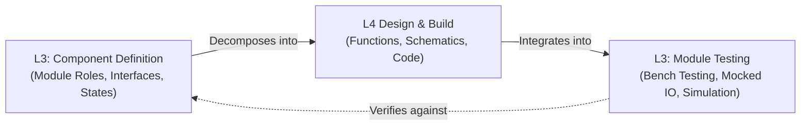
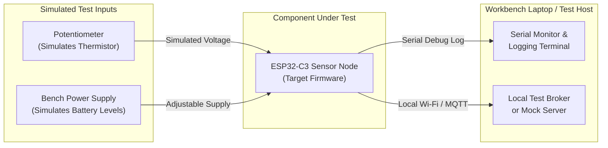

# Component Definition & Module Testing

## Overview

Level 3 (L3) of the lightweight V-Model defines and tests the individual components and modules that make up your project architecture.

- The **Component Definition** (left side of the V) describes how a single module carries out its assigned job from the parent Architecture Definition. It defines the component responsibilities, inputs, outputs, runtime timing, and state model in isolation. It leaves detailed line-by-line algorithms and circuit schematics to Level 4.
- **Module Testing** (right side of the V) verifies the Component Definition. It tests the component by itself on the workbench or in a software test harness. By simulating external inputs and mocking outside services, you prove that the module behaves correctly before assembling the full system.

## At a Glance

| Aspect | Component Definition (Left Side) | Module Testing (Right Side) |
| --- | --- | --- |
| **Core Question** | How does *this* component perform its job? What are its inputs, outputs, and states? | Does this component behave correctly on its own with surrounding signals simulated? |
| **Perspective** | A single component treated as a black box with a defined boundary | Same |
| **Primary Inputs** | Parent Architecture Definition (`AD-001`) and component assignment row | Module Test Plan from the Component Definition |
| **Conducted By** | The builder or developer designing that specific module | The builder testing the isolated module on the bench |
| **Operating Setting** | Design notebook, module notes, or repository documentation | Workbench with simulated inputs (potentiometer, bench supply) or PC test harness |

---

## Part 1: Component Definition (Left Side)

### Purpose

The Component Definition explains **how one component does its work** as assigned by the parent Architecture Definition. It sets responsibilities and interfaces clearly enough to build and test the module in isolation.

Detailed line-by-line formulas, register settings, and pinouts belong in child Functional and Technical Definitions (Level 4).

### What Belongs in the Component Definition

| Section | What to Write | Practical Guidance |
| --- | --- | --- |
| **Component Overview** | Brief summary of what this component is and why it exists as a separate piece. | One paragraph. Link directly to the parent Architecture Definition. |
| **Physical & Logical Placement** | Where this component runs (specific board, microcontroller, or service). | Be precise: "Outdoor Node ESP32-C3," not just "the sensor." |
| **Responsibilities** | Numbered list of functions this component owns. | Each responsibility becomes one or more child Functional Definitions. |
| **Interfaces (Inputs & Outputs)** | Every input and output: ADC channels, GPIO pins, I2C buses, and published topics. | Always include measurement units (°C, V, ms, kPa) and signal directions. |
| **Hardware & Software Dependencies** | Required sensors, driver libraries, RTOS features, or external modules. | List specific libraries (e.g., Adafruit BME280, ESP-IDF Wi-Fi driver). |
| **Runtime & Timing Configuration** | Task priorities, loop rates, sleep timers, and wake intervals. | Ensure timing matches the system power budget from Level 2. |
| **Resource Constraints** | Memory budgets, maximum message buffer sizes, and current draw limits. | Document maximum RAM allocation and sleep current ceilings. |
| **Summary State Model** | Top-level operating states (Boot, Measure, Transmit, Sleep, Fault). | Focus on main states; detailed transition formulas belong in Level 4. |

### What Does Not Belong Here

Keep low-level details out of Level 3:
- Do not restate high-level system topology or multi-node routing (belongs in L2 Architecture).
- Do not write out line-by-line math algorithms or code loops (belongs in L4 Functional Definition).
- Do not list register-level bitmasks or detailed PCB trace layouts (belongs in L4 Technical Definition).

> If detailed math formulas or circuit schematics come to mind while writing, record them in an "Early Technical Notes" appendix for the Level 4 phase.

### States Belong Here (at a Summary Level)

If your component changes behavior based on operational modes, list its main states and what each state represents:
- **`BOOT`**: Power-on initialization, peripheral configuration, and self-test.
- **`SAMPLE`**: Reading physical sensors and converting raw ADC counts to base values.
- **`TRANSMIT`**: Connecting to the network and publishing telemetry payloads.
- **`SLEEP`**: Low-power standby between measurement cycles.
- **`FAULT`**: Fallback state when a sensor probe is disconnected or network communication times out.

Detailed guard conditions, mathematical thresholds, and debounce timers belong in Level 4.

### Illustrative Example: Microcontroller Sensor Node (`CD-002`)

> **Component Definition: Microcontroller Sensor Node (`CD-002`)**
>
> **Parent Architecture:** Sensor Network & Telemetry Architecture (`AD-001`)  
> **Physical Placement:** ESP32-C3 development board inside the North Patio outdoor enclosure.
>
> **Responsibilities:**
> 1. Sample analog thermistor voltage and battery voltage divider on scheduled wake intervals.
> 2. Convert analog sensor readings to calibrated temperature (°C) and battery voltage (V).
> 3. Detect sensor probe disconnects and out-of-range readings.
> 4. Format readings into a structured JSON telemetry payload.
> 5. Manage low-power deep sleep cycles to preserve battery life.
>
> **Interfaces:**
>
> | Interface Name | Direction | Interface Type | Format & Units |
> | --- | --- | --- | --- |
> | `ADC_CH0_THERM` | Input | Analog GPIO pin | 0–3.3 V (raw 12-bit ADC counts) |
> | `ADC_CH1_BATT` | Input | Analog GPIO pin | 0–3.3 V (scaled battery voltage) |
> | `RTC_WAKE_TIMER` | Input | Hardware timer | Periodic wake trigger (every 60 s) |
> | `MQTT_TELEMETRY_OUT` | Output | Wi-Fi / MQTT publish | JSON string (`temp_c`, `battery_v`) |
> | `STATUS_LED` | Output | Digital GPIO pin | Blink pattern for boot and error |

---

## Part 2: Module Testing (Right Side)

### Purpose

Module Testing **verifies the Component Definition**. It tests one component on the workbench while **simulating everything around it**: sensors, actuators, companion boards, and network services.

Because the test environment is controlled, you can safely create conditions that are rare, slow, or difficult to produce in real life (such as extreme temperature swings, dead batteries, or disconnected sensor wires).

### Flavors of Module Testing

Choose the testing method that best fits your project setup:

| Testing Method | How It Works | Best Used For |
| --- | --- | --- |
| **Workbench Bench Testing** | Real component board connected to manual test inputs (potentiometers, bench supply, breadboard signals). | Rapid bring-up, checking analog circuits, verifying sleep currents with a multimeter. |
| **Software-in-the-Loop (SIL)** | Component code compiled to run on your PC with hardware calls replaced by software mocks. | Testing conversion algorithms, state machine logic, and string parsing in seconds without hardware. |
| **Simulated Test Jig (Mini-HIL)** | Real microcontroller on the bench with an automated script (e.g., Python) driving test signals. | Repeatable regression tests, automated voltage sweeps, and overnight reliability runs. |

### Entry Criteria

Before starting Module Testing, verify these items:
- [ ] Child Functional and Technical Definitions (L4) have passed unit tests.
- [ ] Component Definition is completed and reviewed.
- [ ] Test inputs (potentiometer, bench power supply, or software mocks) are prepared.

### Exit Criteria

Module Testing is complete when:
- [ ] Every responsibility in the Component Definition has at least one passing test.
- [ ] Every interface has been driven with test signals and verified with expected outputs.
- [ ] All defined fault conditions (probe disconnect, low battery, network drop) have been injected and handled safely.
- [ ] Active wake duration and sleep current measurements stay within planned budgets.

### What Module Testing Covers

| Category | Practical Test Focus |
| --- | --- |
| **Responsibilities** | Confirm that the module fulfills each assigned job from the Component Definition. |
| **Interface Signals** | Drive each input with minimum, nominal, and maximum signals. Verify output formats and units. |
| **State Transitions** | Verify that the component moves through every defined state (Boot -> Sample -> Transmit -> Sleep). |
| **Fault Injection** | Disconnect input wires, supply low voltages, and simulate network drops to confirm safe handling. |
| **Timing & Execution** | Measure active run time on the bench to ensure wake windows stay under target limits. |
| **Resource Usage** | Check free heap memory and stack usage over repeated test cycles. |
| **Component Isolation** | Test the component with external services mocked so that failures point to this component only. |

### A Typical Maker Workbench Module Test Setup

### Automation & Bench Testing Tips

- **Use a Potentiometer for Sensor Bring-up:** A simple 10k potentiometer lets you sweep the full ADC voltage range to verify calibration formulas and fault detection without heating or cooling a real probe.
- **Use an Adjustable Bench Supply:** Vary the supply voltage from 4.2 V down to 3.0 V to verify battery reading accuracy and low-voltage alert triggers.
- **Keep Tests Data-Driven:** Use a table of known input voltages and expected output temperatures to verify calibration accuracy across the entire operating range.
- **Tag Test Cases:** Assign each test case an ID (`MT-XXX-01`) referencing the responsibility or interface it verifies.

---

## Common Pitfalls

| Pitfall | Problem | Solution |
| --- | --- | --- |
| **Interfaces listed without units** | Calculations fail because one person assumed Fahrenheit while another used Celsius. | Always specify units (°C, V, mA, ms) for every numeric input and output. |
| **Untested responsibilities** | A stated responsibility has no matching functional code or test case. | Ensure every responsibility decomposes into an L4 definition and has a verifying test case. |
| **Testing only ideal inputs** | Devices crash in the field when real-world wires disconnect or voltages sag. | Inject deliberate faults on the bench: disconnect sensor leads and drop power supply voltages. |
| **Skipping isolated module tests** | Testing only during full system assembly makes it difficult to tell which board caused a bug. | Test each module by itself with simulated inputs before connecting to the full system. |

### Illustrative Test Case

| Test Field | Value |
| --- | --- |
| **Test ID** | `MT-NODE-002` |
| **Verifies** | Component Definition: Microcontroller Sensor Node (`CD-002`), Responsibility 3 (Probe Fault Handling) |
| **Setup** | ESP32-C3 Sensor Node on workbench; serial monitor attached; input lead disconnected from analog pin. |
| **Test Procedure** | 1. Power on the node with the thermistor input lead disconnected (open circuit). 2. Observe boot diagnostic output on the serial terminal. 3. Verify the node identifies the out-of-range ADC reading as an open circuit. 4. Observe the formatted MQTT payload sent to the local test broker. 5. Confirm the status LED flashes the defined fault error code. |
| **Expected Result** | The node does not crash or transmit a false 0 °C reading. It publishes `{"temp_c": null, "error": "probe_open"}` and enters deep sleep normally. |
| **Evidence Captured** | Serial terminal log showing fault detection; test broker message capture confirming error payload. |
