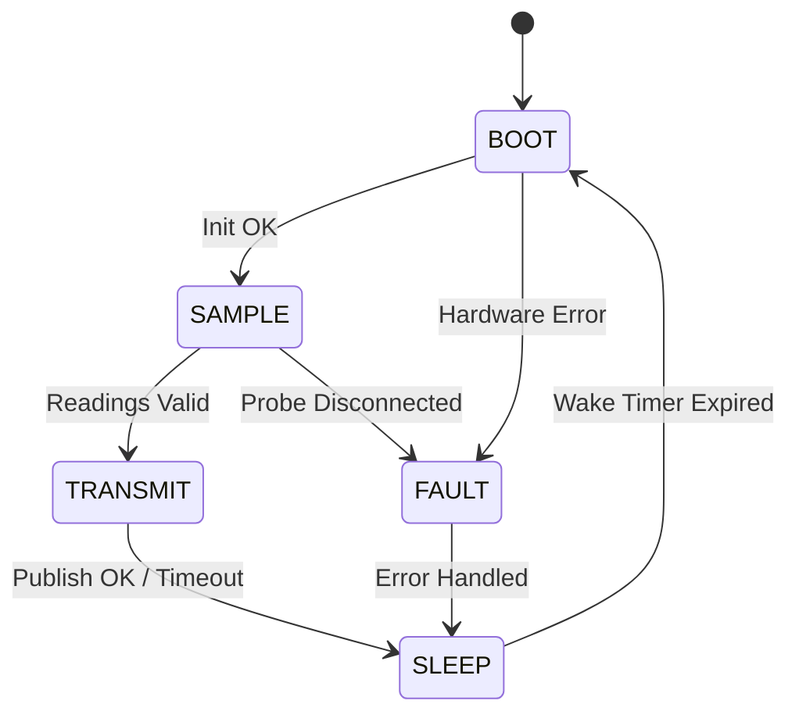

# Component Definition Template

*Use this template to define a single component or module at Level 3 (L3) of the lightweight V-Model. The Component Definition describes how one component carries out its assigned job from the parent Architecture Definition. It defines responsibilities, interfaces, runtime timing, and state behavior in isolation before detailed coding begins.*

---

# [Component Name]

- **Document ID:** CD-[XXX] (e.g., `CD-001` or `CD-TEMP-NODE`)
- **Parent Architecture:** [AD-XXX: Architecture Definition Name]
- **Parent Project:** [PD-XXX: Project Definition Name]
- **Author / Builder:** [Name]
- **Status:** [Draft | In Review | In Progress | In Module Testing | Complete]
- **Target Date:** [YYYY-MM-DD]

---

## 1. Component Overview

*Provide a brief summary of this component. Explain what it is, why it exists as a separate piece, and which part of the system architecture it fulfills.*

- **Component Purpose:** [Summarize what this component does in 1–2 sentences.]
- **Role in the Architecture:** [Explain how this component interacts with peer modules or the parent architecture.]

---

## 2. Physical & Logical Placement

*Specify where this component lives physically and logically.*

- **Hardware Target / Board:** [e.g., ESP32-C3 development board, Raspberry Pi, Arduino Nano, custom PCB.]
- **Physical Location / Enclosure:** [e.g., North patio weatherproof box, upstairs hallway wall mount, bench test chassis.]
- **Software Runtime / Environment:** [e.g., Bare-metal C/C++, FreeRTOS task, ESPHome firmware, Python daemon.]

---

## 3. Component Responsibilities

*List the specific functions and behaviors this component owns. Each numbered responsibility will decompose into one or more child Functional Definitions (Level 4).*

1. **[RESP-1]:** [Primary function, e.g., Sample analog thermistor voltage and battery voltage divider on scheduled wake intervals.]
2. **[RESP-2]:** [Data processing function, e.g., Convert raw ADC counts into calibrated temperature (°C) and battery voltage (V).]
3. **[RESP-3]:** [Fault handling function, e.g., Detect sensor probe disconnects and out-of-range ADC readings.]
4. **[RESP-4]:** [Communication function, e.g., Format sensor readings into a structured JSON telemetry payload.]
5. **[RESP-5]:** [Power management function, e.g., Manage low-power deep sleep cycles and wake timers.]

---

## 4. Interfaces (Inputs & Outputs)

*List every signal, message, and communication line crossing this component boundary. Always specify units, signal types, and directions.*

| Interface ID | Interface Name | Direction | Type / Protocol | Units / Data Format | Connected To |
| --- | --- | --- | --- | --- | --- |
| **IF-01** | `[e.g., ADC_CH0_THERM]` | Input | Analog Pin | 0–3.3 V (12-bit raw ADC count) | [Thermistor voltage divider] |
| **IF-02** | `[e.g., ADC_CH1_BATT]` | Input | Analog Pin | 0–3.3 V (scaled battery voltage) | [Battery divider circuit] |
| **IF-03** | `[e.g., RTC_WAKE_TIMER]` | Input | Hardware Timer | Milliseconds / periodic (60 s) | [Internal RTC timer] |
| **IF-04** | `[e.g., MQTT_TELEMETRY]` | Output | Wi-Fi / MQTT | JSON string (`temp_c`, `battery_v`) | [Local MQTT broker] |
| **IF-05** | `[e.g., STATUS_LED]` | Output | Digital GPIO | High / Low (blink pulse) | [Onboard diagnostic LED] |

---

## 5. Hardware & Software Dependencies

*Identify all required external libraries, hardware drivers, and physical peripherals.*

- **Hardware Peripherals:** [e.g., Internal 12-bit ADC, RTC timer, Wi-Fi radio, onboard LED.]
- **External Modules / Sensors:** [e.g., 10k NTC thermistor probe, 18650 battery holder, 3.3V LDO regulator.]
- **Software Libraries & Drivers:** [e.g., ESP-IDF Wi-Fi driver, PubSubClient MQTT library, Arduino core.]

---

## 6. Runtime & Timing Configuration

*Specify task scheduling, loop rates, sleep timers, and execution windows.*

- **Execution Model:** [e.g., Single-threaded loop, FreeRTOS task, event-driven interrupt handler.]
- **Operating Timing & Intervals:**
  - *Active Wake Duration:* [e.g., Maximum 2.5 seconds per wake cycle.]
  - *Sleep Interval:* [e.g., 60 seconds in deep sleep between samples.]
  - *Sample Read Time:* [e.g., 100 ms average over 10 ADC readings.]
- **Task Priorities (if using an RTOS):** [e.g., Main sensor task priority 5, network task priority 10.]

---

## 7. Resource Constraints

*Document memory, power, and bandwidth ceilings allocated to this component from Level 2.*

- **Memory Ceiling:** [e.g., Maximum 16 KB RAM allocation; no dynamic memory allocation inside main loop.]
- **Power & Current Budget:**
  - *Peak Active Current:* [e.g., Maximum 300 mA during Wi-Fi transmission.]
  - *Deep Sleep Current:* [e.g., Maximum 25 microamps in deep sleep.]
  - *Target Battery Lifespan:* [e.g., At least 6 months on a single 2500 mAh 18650 cell.]
- **Message Size Limits:** [e.g., JSON payload size strictly under 128 bytes.]

---

## 8. Summary State Model

*List the top-level operating states for this component. Leave detailed transition formulas and bit-level guards to Level 4.*

- **`BOOT`**: [Power-on initialization, pin configuration, and hardware self-test.]
- **`SAMPLE`**: [Read analog pins, convert raw counts to calibrated units, validate readings.]
- **`TRANSMIT`**: [Connect to network, publish formatted telemetry payload.]
- **`SLEEP`**: [Disable peripherals, configure wake timer, enter low-power deep sleep.]
- **`FAULT`**: [Flag error condition, flash diagnostic LED, prepare error payload.]

---

## 9. Module Test Plan (Right Side of the V)

*Outline how this component will be tested in isolation on the workbench before connecting to the full system. Every responsibility and interface must be verified.*

### Test Bench Environment Setup
- **Hardware on Bench:** [Component board, breadboard wiring, bench power supply, multimeter.]
- **Simulated Test Inputs:** [Potentiometer to simulate sensor voltages, adjustable supply to simulate battery drain.]
- **Test Host & Monitoring:** [PC with serial monitor terminal, local test MQTT broker.]

### Entry Criteria
- [ ] Child Functional and Technical Definitions (L4) drafted and verified.
- [ ] Component Definition completed and reviewed.
- [ ] Test bench inputs (potentiometer, bench supply) connected.

### Exit Criteria
- [ ] Every responsibility (`RESP-1` to `RESP-5`) verified with at least one passing test case.
- [ ] Every interface verified with correct units and signal levels.
- [ ] Fault injection tests (open circuit, low battery, network drop) pass safely.
- [ ] Active wake duration and sleep current meet numeric targets.

### Module Test Cases

| Test ID | Verifies (RESP / IF) | Test Procedure Summary | Expected Result | Pass / Fail |
| --- | --- | --- | --- | --- |
| **MT-001** | [RESP-1, IF-01] | [Sweep input potentiometer from 0 V to 3.3 V; observe serial output.] | [Reported ADC counts match input voltage across full range.] | [ ] |
| **MT-002** | [RESP-2] | [Supply known voltage corresponding to 25 °C; check temperature output.] | [Reported temperature reads 25.0 °C ±0.3 °C.] | [ ] |
| **MT-003** | [RESP-3, IF-05] | [Disconnect analog sensor wire to simulate open circuit.] | [Node flags probe fault, sets status LED, publishes error payload.] | [ ] |
| **MT-004** | [RESP-5] | [Measure sleep current with multimeter while node is in SLEEP state.] | [Current drops to <= 25 microamps; node wakes after 60 seconds.] | [ ] |

---

## 10. Early Technical Notes (Scratchpad for L4 Functional & Technical Definitions)

*Do not put line-by-line code algorithms, register bitmasks, or circuit trace details into the component sections above. Jot down early technical thoughts here for the Level 4 phase.*

- *Algorithm Ideas:* [e.g., Use Steinhart-Hart equation or beta parameter equation (beta = 3950) for thermistor conversion.]
- *Register & Pin Notes:* [e.g., Use ADC1 Channel 0 (GPIO 0) because ADC2 conflicts with Wi-Fi on ESP32 chips.]
- *Filter Thoughts:* [e.g., Take 10 ADC samples with 5 ms delay, discard min/max, average remaining 8.]
