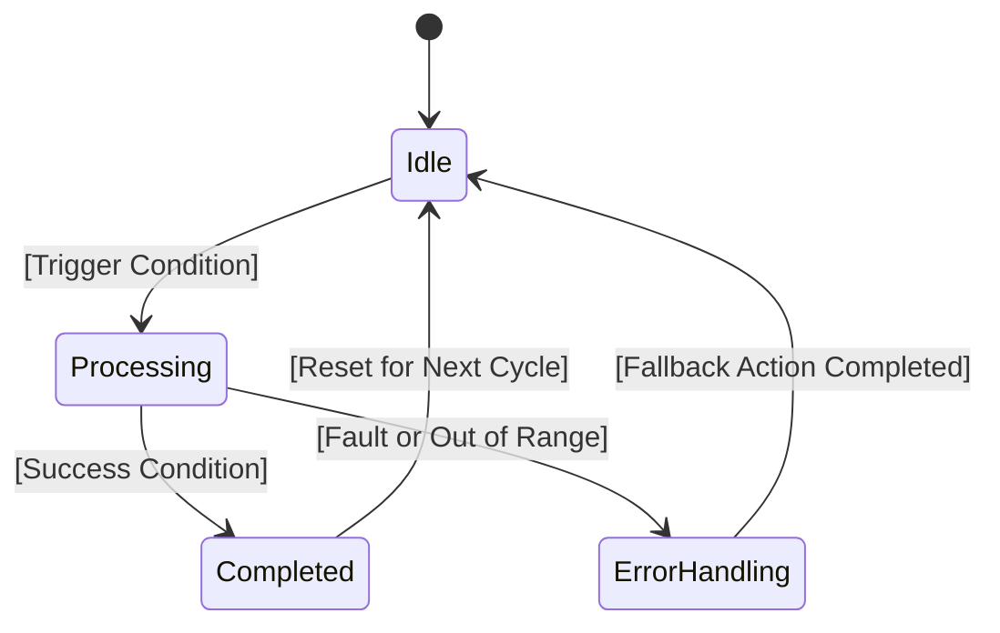

# Functional Definition Template

*Use this template to define the detailed behavior of a single function, routine, mechanism, or operation at Level 4 (L4) of the lightweight V-Model. The Functional Definition explains what happens under normal and abnormal scenarios. It breaks down one responsibility from the parent Component Definition without locking in specific hardware part numbers or hardcoded constants.*

---

# [Functional Definition Title]

- **Document ID:** FD-[XXX] (e.g., `FD-DRAIN-01: Shower Drain Pre-Slope Pitch` or `FD-TEMP-01: Thermistor Sample Filtering`)
- **Parent Component:** [CD-XXX: Component Name] (e.g., `CD-004: Shower Waterproofing Pan` or `CD-001: Sensor Node`)
- **Parent Architecture:** [AD-XXX: Architecture Definition Name]
- **Parent Project:** [PD-XXX: Project Definition Name]
- **Author / Builder:** [Name]
- **Status:** [Draft | In Review | In Build / Fabrication | In Unit Testing | Complete]
- **Target Date:** [YYYY-MM-DD]

---

## 1. Functional Overview & Scope

*Summarize what this function or mechanism does, what triggers it, and which responsibility from the parent Component Definition it fulfills.*

- **Function Purpose:** [Summarize what this specific function does in 1–2 sentences.]
- **Parent Responsibility:** [Link directly to parent Component Definition responsibility, e.g., CD-004 RESP-2: Maintain 1/4 in/ft pre-slope.]
- **Trigger / Execution Model:** [How or when this runs, e.g., Periodic timer tick every 60 seconds, user button press, or physical gravity drain flow.]

---

## 2. Inputs & Outputs

*List all data values, sensor voltages, physical flows, or user inputs that enter or leave this function.*

| Signal / Data Name | Direction | Type / Medium | Valid Range & Units | Description |
| --- | --- | --- | --- | --- |
| **[Input 1]** | Input | [e.g., Analog Voltage / PEX line] | [e.g., 0.0 to 3.3 V / 40 to 60 PSI] | [Raw sensor voltage from thermistor divider] |
| **[Input 2]** | Input | [e.g., Digital State / Level] | [e.g., HIGH / LOW or Pitch angle] | [Wakeup trigger / slope measurement] |
| **[Output 1]** | Output | [e.g., Float / Drainage Pitch] | [e.g., -10.0 to 45.0 °C / 0.25 to 0.5 in/ft] | [Calculated temperature / finished mortar slope] |
| **[Output 2]** | Output | [e.g., Status Code / Flag] | [e.g., OK, ERR_TIMEOUT, ERR_OUT_OF_RANGE] | [Execution status flag] |

---

## 3. Detailed Functional Statements

*Write numbered, testable statements describing the exact behavior. Use "shall" to indicate required behavior that Unit Testing verifies.*

1. **[FD-XXX-1.1]:** [Normal behavior statement, e.g., The function shall capture 5 consecutive analog voltage readings at 50 ms intervals.]
2. **[FD-XXX-1.2]:** [Data transformation statement, e.g., The function shall discard the highest and lowest readings and compute the mean of the remaining 3 samples.]
3. **[FD-XXX-1.3]:** [Threshold or trigger statement, e.g., When the filtered temperature drops below the cool threshold, the function shall set the cool_alert flag to true.]
4. **[FD-XXX-1.4]:** [Physical criteria statement, e.g., The mortar bed shall maintain a continuous downward slope between 1/4 inch and 1/2 inch per horizontal foot toward the drain flange.]

---

## 4. Processing Logic & State Transitions

*Detail step-by-step algorithms, calculation logic, or operating states. Use a Mermaid state diagram if the function moves through multiple states.*

- **Step 1:** [Describe initial preparation or signal capture.]
- **Step 2:** [Describe core transformation, filtering, or physical alignment.]
- **Step 3:** [Describe output generation or latching.]

---

## 5. Edge Cases & Error Handling

*Describe how the function behaves when inputs are missing, corrupted, out of range, or physically obstructed.*

| Condition / Fault | Detection Mechanism | Fallback / System Behavior | Recovery Action |
| --- | --- | --- | --- |
| **[Out-of-range Input]** | [e.g., Voltage < 0.05 V or > 3.25 V] | [Discard sample; log ERR_OUT_OF_RANGE; retain last known good reading] | [Resume updating when reading returns to valid range] |
| **[Timeout / Signal Loss]** | [e.g., No response within 200 ms] | [Abort attempt; increment retry counter; sleep until next cycle] | [Retry on next scheduled interval] |
| **[Physical Obstruction / Flat Spot]** | [e.g., Digital level reads < 0.25 in/ft] | [Mark section with chalk; screed additional mortar before curing] | [Re-check level before mortar sets] |

---

## 6. Safety Limits & Critical Constraints

*List non-negotiable physical, electrical, or thermal boundaries that must never be violated.*

- **Physical Boundaries:** [e.g., Screed thickness must never drop below 1/2 inch at the drain ring.]
- **Electrical / Thermal Limits:** [e.g., Current draw during ADC sampling must stay under 15 mA; temperature cannot exceed 50 °C.]
- **Safety Interlocks:** [e.g., Do not activate heating element if thermistor indicates open circuit.]

---

## 7. Unit Test Plan (Right Side of the V)

*Outline how this isolated function, mechanism, or cut will be verified against the statements above before integration.*

### Test Setup & Tools
- **Test Equipment:** [e.g., Digital multimeter, 24-inch digital level, host script test harness, or bench power supply.]
- **Test Location:** [Workbench test rig, prototype breadboard, or rough-in mortar bed.]

### Entry Criteria
- [ ] Functional Definition reviewed and approved.
- [ ] Test tools on hand and verified against known reference.
- [ ] Test fixture, code function, or rough material prepared.

### Exit Criteria
- [ ] All numbered functional statements ([FD-XXX-1.1] through [FD-XXX-1.4]) pass testing.
- [ ] All edge cases and error conditions tested and verified.
- [ ] Test results recorded and signed off.

### Unit Test Cases

| Test ID | Verifies (FD Statement) | Test Procedure Summary | Expected Result | Pass / Fail |
| --- | --- | --- | --- | --- |
| **UT-001** | [FD-XXX-1.1, FD-XXX-1.2] | [Supply sample array with known values; execute filtering function.] | [Trimmed average matches expected value within stated tolerance.] | [ ] |
| **UT-002** | [FD-XXX-1.3] | [Simulate condition crossing active threshold.] | [Alert flag sets to true within 1 cycle.] | [ ] |
| **UT-003** | [FD-XXX-1.4] | [Measure slope across all radial lines from perimeter to center.] | [All readings measure between 1/4 in/ft and 1/2 in/ft.] | [ ] |
| **UT-004** | [Edge Cases] | [Provide out-of-range input value.] | [Error code returned; no crash or invalid state.] | [ ] |

---

## 8. Early Technical Notes (Scratchpad for Technical Definition)

*Do not hardcode specific formulas, pinouts, or mix ratios in the behavioral sections above. Record them here for the matching Technical Definition (TD).*

- *Formula / Math Constants:* [e.g., Steinhart-Hart coefficients: A = 1.129e-3, B = 2.341e-4, C = 8.775e-8.]
- *Hardware Pinout / Wire Specs:* [e.g., Analog input on GPIO 0; fixed pull-up resistor 10.0 kOhm 0.1%.]
- *Mix / Material Specs:* [e.g., 4:1 sand-to-Portland cement by volume; dry-pack consistency.]
