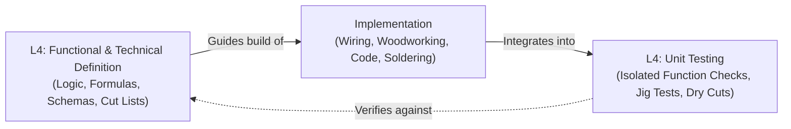
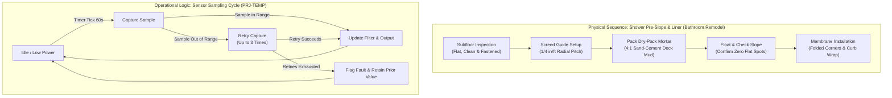

# Functional & Technical Definition & Unit Testing

## Overview

Level 4 (L4) of the lightweight V-Model defines and tests the lowest-level building blocks of your project: individual functions, calculations, physical cuts, circuits, and exact technical specifications.

- The **Functional Definition** (left side of the V) describes the detailed behavior of a single function, mechanism, or operation. It states what happens under normal and abnormal conditions without getting bogged down in low-level part numbers.
- The **Technical Definition** (optional, left side of the V) captures exact numerical specifications, formulas, pin maps, data schemas, or material mix ratios that must be implemented with precision.
- **Unit Testing** (right side of the V) verifies that each isolated function, circuit, or crafted piece behaves exactly as defined before it joins the larger component.

While Level 3 (Component Definition) establishes what an entire subsystem or trade owns, Level 4 defines the exact logic and measurements that make that subsystem work.

---

## At a Glance

| Aspect | Functional & Technical Definition (Left Side) | Unit Testing (Right Side) |
| --- | --- | --- |
| **Core Question** | Exactly how does this specific function, cut, formula, or circuit behave? | Does this single routine, joint, or circuit block perform correctly in isolation? |
| **Perspective** | The lowest-level detail: one function, one sensor calibration, one plumbing slope calculation | Quick, isolated checks of one piece of logic or hardware |
| **Primary Inputs** | Parent Component Definition (`CD-XXX`) responsibilities and interfaces | Functional statements and test vectors from L4 definitions |
| **Conducted By** | Project builder or maker planning the detailed work | Project builder running bench checks, script tests, or dimensional inspections |
| **Operating Setting** | Project notes, calculation sheets, breadboard sketches, or code docstrings | Test bench, workbench jig, script terminal, or physical measuring layout |

---

## Part 1: Functional & Technical Definition (Left Side)

### Purpose

The Functional Definition breaks down one responsibility from a parent Component Definition into step-by-step behavior. It defines:
- What initiates the action, physical movement, or process.
- What inputs, raw materials, or measurements are required.
- How those inputs transform into finished cuts, physical shapes, or calculated outputs.
- How mistakes, out-of-bounds measurements, or adverse site conditions are handled.

When a feature depends on exact dimensions, cut lists, material mix ratios, wiring pinouts, or mathematical formulas, an accompanying **Technical Definition** provides those specific parameters.

### What Belongs in a Functional Definition

| Section | What to Write | Practical Guidance |
| --- | --- | --- |
| **Functional Overview** | What this specific function, mechanism, cut, or process accomplishes. | Link directly to the parent Component Definition responsibility (`RESP-n`). |
| **Inputs & Outputs** | Every raw material, measurement, signal, or resulting dimension/value. | Specify physical units (1/4 inch, 40 PSI, 2x4 lumber) alongside data units (0–3.3 V, °C). |
| **Processing Logic & Rules** | Step-by-step assembly rules, cutting steps, calculation logic, or physical progressions. | Use numbered sequence steps or flow/state diagrams. |
| **Edge Cases & Error Handling** | How the process or routine reacts when materials are out of square, dimensions conflict, readings drift, or signals drop. | Define exact adjustments, material trimming, or fallback behavior. |
| **Safety Limits & Critical Constraints** | Non-negotiable physical clearances, structural load limits, electrical thresholds, or fire/moisture barriers. | Document maximum temperatures, cut depth limits, curb heights, or electrical current ceilings. |

### What Belongs in a Technical Definition (Optional)

A Technical Definition is needed when two physical parts must mate with exact tolerances, when a material recipe requires strict proportions, or when a calculation requires fixed constants.

| Section | What to Write | Practical Guidance |
| --- | --- | --- |
| **Technical Overview** | Summary of the exact technical parameters, tolerances, and specifications. | Link directly to the matching Functional Definition. |
| **Formulas, Ratios & Calculations** | Exact equations, material mix recipes, conversion factors, or slope percentages. | Write complete equations with all terms defined (e.g., 4:1 sand-cement deck mud mix, Steinhart-Hart thermistor coefficients). |
| **Dimensions, Cut Lists & Material Specs** | Exact piece lengths, lumber grades, pipe schedules, fastener types, or board thicknesses. | Detail dimensions, lumber grades, thread types (e.g., 1/2-in NPT), and fastener spacing schedules. |
| **Data Schemas, Pinouts & Interfaces** | Specific GPIO numbers, ADC channels, wire color codes, or JSON payload keys (when applicable). | Document physical terminal wiring, logic voltage levels, and telemetry formats. |
| **Test Vectors & Inspection Benchmarks** | A table of known inputs and expected outputs, or physical gauge checkpoints. | These become direct test cases for unit testing. |

### What Does Not Belong Here

- **High-level architecture**: Do not describe whole-system block diagrams or inter-board network layouts (belongs in L2 Architecture Definition).
- **Subsystem trade scope**: Do not define entire rooms or complete tool frames (belongs in L3 Component Definition).
- **Project goals or budgets**: Do not discuss user personas or total material cost goals (belongs in L1 Project Definition).

### Writing Precise Functional Statements

Write requirements as clear, numbered, testable statements. Use **shall** to indicate mandatory behavior that unit tests will verify.

| Weak Statement | Strong Statement |
| --- | --- |
| "Slope the mortar to the drain." | **FD-DRAIN-1.1:** The pre-slope mortar bed shall maintain a continuous downward pitch between 1/4 inch and 1/2 inch per horizontal foot from all perimeter walls to the clamping drain edge. |
| "Wrap the liner up the walls." | **FD-DRAIN-1.2:** The waterproof pan liner shall extend vertically up all perimeter framing studs to a minimum height of 6 inches above the finished curb threshold. |
| "Smooth the temperature reading." | **FD-TEMP-1.1:** The function shall calculate a rolling average of the last 5 valid temperature samples taken at 1-second intervals. |
| "Handle disconnected sensors." | **FD-TEMP-1.2:** If the sensor analog reading falls below 0.05 V or exceeds 3.25 V, the function shall mark the reading invalid and retain the last known valid value for up to 3 cycles. |

### State Transitions & Sequences

Many processes follow a strict progression or cycle through defined operational states:
- In **physical trades**, a sequence defines irreversible assembly steps (such as framing $\to$ pre-slope $\to$ membrane $\to$ flood test) or physical flows (such as water moving from tile surface to drain weep holes).
- In **electronics or software**, a state machine defines how logic moves between operational modes (such as idle, sampling, validating, and sleep) to prevent unhandled conditions.

### Test Vectors & Inspection Benchmarks: The Bridge to Unit Testing

Test vectors and inspection benchmarks are pairs of known inputs and expected results. They allow you to test your cuts, mixtures, or calculations in isolation before assembling the full piece:

| Benchmark / Vector ID | Domain | Input / Inspection Point | Expected Benchmark / Output | Verification Purpose |
| --- | --- | --- | --- | --- |
| **BM-DRAIN-01** | Physical Trade | 24-inch digital level placed along mortar radial line | Pitch reads between 0.25 and 0.50 in/ft | Slope pitch verification |
| **BM-DRAIN-02** | Physical Trade | Handful of mixed dry-pack mortar squeezed firmly in fist | Mortar forms cohesive ball without weeping water | Deck mud moisture consistency check |
| **BM-DRAIN-03** | Physical Trade | Tape measure from top of curb to pan liner top edge | Membrane height reads $>= 6.0 inches$ on all walls | Waterproof containment margin |
| **TV-TEMP-01** | Electronics / Math | Raw ADC voltage = 1.49 V (1850 counts) | Converted temperature = 21.5 °C | Nominal room temperature verification |
| **TV-TEMP-02** | Electronics / Math | Raw ADC voltage = 2.58 V (3200 counts) | Converted temperature = 0.2 °C | Near-freezing boundary point check |
| **TV-TEMP-03** | Electronics / Math | Raw ADC voltage < 0.05 V (open circuit) | Error returned: `ERR_DISCONNECTED` | Lower open-circuit fault detection |

---

## Part 2: Unit Testing (Right Side)

### Purpose

Unit Testing **verifies the Functional and Technical Definitions**. It checks each individual function, joint, calculation, or circuit section by itself.

Testing at Level 4 provides fast feedback. When a unit test fails, the bug is isolated to that specific routine, cut, or wire. You fix it immediately before it affects the rest of the build.

### Common Flavors of Unit Testing across DIY Projects

| Project Domain | What Is Tested at L4 | Typical Test Method |
| --- | --- | --- |
| **Physical Trades & Construction** | Slope angle, board dimensions, joint squareness, mortar consistency | Torpedo level check, 3-4-5 triangle layout rule, slump cone check, digital caliper measurement |
| **Electronics & Hardware** | Resistor divider ratio, sensor output voltage, power rail ripple | Benchtop digital multimeter, oscilloscope probe, dummy load test |
| **Firmware & Scripts** | Filter math, calibration equations, string parsing, JSON payload formatting | Standalone test script, unit test runner, interactive Python or shell session |

### Designing for Testability

To make small-scale projects easy to unit test:
- **Isolate formulas from hardware**: Write calculation functions so they take raw numbers and return results without reading pins directly. You can test them on your computer before flashing them to a board.
- **Dry-test cuts and joints**: Test-fit mortise-and-tenon joints, lap joints, or pipe threads before applying glue, primer, or solder.
- **Provide test points**: Add labeled pins or test pads on custom circuit boards so a multimeter probe can verify voltages quickly.

### Entry Criteria

Before starting Unit Testing, verify:
- [ ] Functional Definition and Technical Definition (if applicable) are written and reviewed.
- [ ] Test tools (calipers, level, multimeter, or test script) are on hand and calibrated.
- [ ] The isolated function, code module, cut piece, or test circuit is ready.

### Exit Criteria

Unit Testing is complete when:
- [ ] Every numbered functional requirement (`FD-XXX-nn`) passes its test.
- [ ] All test vectors produce expected results within stated tolerances.
- [ ] Error conditions and boundary cases behave safely as specified.
- [ ] Results are logged before assembling the part into the Level 3 component.

---

## Two Illustrative Examples

### Example A: Physical Home Improvement (Bathroom Remodel)

> **Functional Definition: Shower Pan Pre-Slope Pitch (`FD-DRAIN-01`)**  
> **Parent Component:** Shower Waterproofing Pan (`CD-004`), Responsibility 2  
> **Location:** Master Bathroom Shower Floor  
> 
> **Functional Statements:**
> - **FD-DRAIN-01.1:** The pre-slope mortar bed shall provide a uniform downward slope from all four room perimeter walls toward the clamping drain body.
> - **FD-DRAIN-01.2:** The slope pitch shall measure between 1/4 inch and 1/2 inch per horizontal foot across every radial line from wall to drain.
> - **FD-DRAIN-01.3:** The perimeter screed height shall remain uniform within ±1/8 inch around the entire shower footprint.
> 
> **Technical Definition: Mortar Mix & Dimensions (`TD-DRAIN-01`)**  
> - *Mix Ratio:* 4 parts clean masonry sand to 1 part Portland cement by volume (dry-pack consistency).  
> - *Water Content:* Just enough water so a squeezed handful retains shape without dripping moisture (deck mud).  
> - *Thickness Limits:* Minimum 1/2 inch at the drain ring; maximum $1\text{-}1/2\text{ inches}$ at the farthest wall corner.

#### Unit Test Case: Pre-Slope Radial Pitch Inspection

| Test Field | Record Details |
| --- | --- |
| **Test ID** | `UT-SLOPE-001` |
| **Verifies** | Functional Statements `FD-DRAIN-01.1`, `FD-DRAIN-01.2`, and `FD-DRAIN-01.3` |
| **Setup** | Mortar bed placed and screeded; 24-inch digital level calibrated on flat reference plate. |
| **Test Procedure** | 1. Place level radially from each of the four corners to the central drain. 2. Measure slope reading in inches per foot. 3. Place level from wall midpoints to drain along four cardinal directions. 4. Verify screed height at all four wall corners with a tape measure. |
| **Expected Result** | All 8 radial pitch measurements fall between 0.25 in/ft and 0.50 in/ft. Corner heights are equal within ±1/8 inch. Zero flat spots or reverse slopes. |
| **Evidence Captured** | Photo of digital level showing 0.30 in/ft slope; inspection log signed off. |

---

### Example B: Maker & Electronics Project (Home Temperature Monitor)

> **Functional Definition: Thermistor Sample Filtering & Scaling (`FD-TEMP-01`)**  
> **Parent Component:** Outdoor Sensor Node (`CD-001`), Responsibility 3  
> **Location:** North Patio Sensor Enclosure  
> 
> **Functional Statements:**
> - **FD-TEMP-01.1:** The function shall read 5 consecutive ADC voltage samples spaced 50 ms apart upon wakeup.
> - **FD-TEMP-01.2:** The function shall discard the highest and lowest samples and calculate the arithmetic mean of the remaining 3 samples.
> - **FD-TEMP-01.3:** The function shall convert the average ADC voltage to degrees Celsius using the Steinhart-Hart equation.
> - **FD-TEMP-01.4:** If the calculated temperature is below -20 °C or above 60 °C, the function shall return `ERR_OUT_OF_RANGE`.
> 
> **Technical Definition: Steinhart-Hart Constants & ADC Map (`TD-TEMP-01`)**  
> - *ADC Pin:* GPIO 0 (12-bit ADC, 0–4095 counts, 0–3.3 V reference).  
> - *Fixed Divider Resistor:* 10.0 kΩ ±0.1%.  
> - *Thermistor Coefficients:* $A = 1.129\times 10^{-3}$, $B = 2.341\times 10^{-4}$, $C = 8.775\times 10^{-8}$.  
> - *Telemetry Output Format:* JSON string `{"temp_c": 21.4, "status": "OK"}`.

#### Unit Test Case: Averaging & Calibration Math Check

| Test Field | Record Details |
| --- | --- |
| **Test ID** | `UT-SAMP-001` |
| **Verifies** | Functional Statements `FD-TEMP-01.2`, `FD-TEMP-01.3`, and `FD-TEMP-01.4` |
| **Setup** | Run host calculation test script with predefined raw ADC sample arrays. |
| **Test Procedure** | 1. Pass input array `[1840, 1850, 1860, 2400, 1200]` into filtering function. 2. Verify trimmed average selects 1840, 1850, 1860 (mean $= 1850$). 3. Check converted temperature against test vector `TV-TEMP-01` (21.5 °C ±0.1 °C). 4. Pass array `[4050, 4050, 4050, 4050, 4050]` and check for `ERR_OUT_OF_RANGE`. |
| **Expected Result** | Trimmed filter removes spikes; temperature converts to 21.5 °C; high-voltage short triggers `ERR_OUT_OF_RANGE`. |
| **Evidence Captured** | Test script execution log showing all 4 assertions passed. |

---

## Common Pitfalls in Functional & Technical Work

| Pitfall | Problem | Solution |
| --- | --- | --- |
| **Mixing behavior and numbers in one messy doc** | Changing a resistor value or mortar ratio forces rewriting the behavioral logic. | Separate behavior into the Functional Definition and specific constants into the Technical Definition. |
| **Untestable functional statements** | Statements like "system should run smoothly" cannot be proven true or false. | Use numbered "shall" statements with specific measurable thresholds and tolerances. |
| **Testing only nominal values** | Edge cases (freezing temps, disconnected wires, wet mortar) cause quiet failures during full assembly. | Include out-of-range, open-circuit, and boundary conditions in your test vectors. |
| **Tying formulas to physical hardware pins** | Math routines cannot be tested without burning microcontroller chips or wiring full circuits. | Structure code so math routines take numbers as arguments and return results, making them easy to test on a computer. |
| **Skipping dry checks before assembly** | Cutting materials without checking measurements wastes expensive wood, pipe, or circuit boards. | Perform dimensional inspections and dry test-fits as formal unit tests before applying glue, solvent, or heat. |

---

## Traceability

- **Parent:** Decomposes from one Level 3 Component Definition (`CD-XXX`) responsibility.
- **Children:** Implemented directly in code routines, wiring runs, or physical cuts.
- **Verified by:** Level 4 Unit Test cases (`UT-XXX-nnn`), which directly reference the functional requirement ID (`FD-XXX-nn`) or test vector (`TV-XXX-nn`) they verify.
