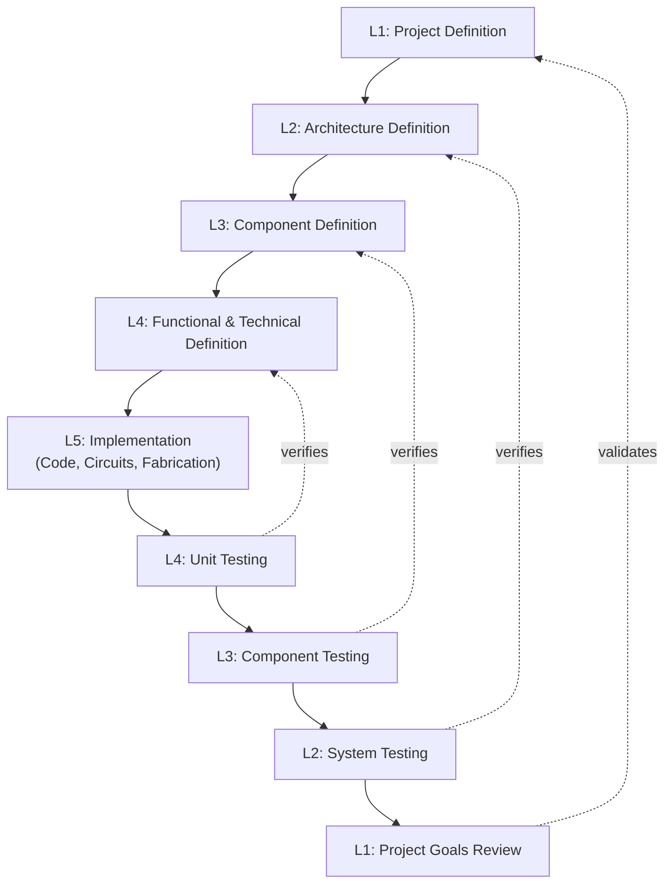

# Implementation

## Overview

**Implementation** sits at the base of the lightweight V-Model (Level 5). It is the stage where design definitions turn into physical hardware, assembled materials, soldered circuits, or compiled source code.

- **The Left Side of the V** decomposes requirements down to precise behavioral rules and technical specifications (Levels 1 through 4).
- **The Base of the V** is Implementation: building, assembling, wiring, and coding according to those definitions.
- **The Right Side of the V** integrates and tests the build upward, starting with Unit Testing and concluding with the Project Goals Review.

Implementation connects design specifications to physical verification. When a test passes or fails, clear implementation records show exactly what code was compiled, which joints were cut, and which wires were soldered.

---

## At a Glance

| Aspect | Functional & Software Implementation | Physical & Hardware Implementation |
| --- | --- | --- |
| **Primary Domain** | Microcontroller firmware, software scripts, configuration files, logic rules | Circuit breadboards, soldered PCBs, framing lumber, pipe runs, mechanical joints |
| **Key Inputs** | Functional Definition (`FD-xxx`) and Technical Definition (`TD-xxx`) | Component Definition (`CD-xxx`), Technical Definition (`TD-xxx`), cut lists, schematics |
| **Core Activity** | Writing code, importing libraries, configuring peripherals, compiling binaries | Cutting, fitting, assembling, fastening, soldering, wiring, crimping |
| **Output Artifacts** | Source code files, commit hashes, compiled firmware images, configuration manifests | Assembled workpieces, soldered circuit boards, completed rough-in installations |
| **Immediate Verification** | Level 4 Unit Testing (`UT-nnn`) via test harnesses, vectors, or assertion suites | Level 4 Unit Testing / bench checks (`UT-nnn`, `BM-nn`) via calipers, levels, multimeters |

---

## Why Implementation Documentation Matters

Without organized implementation records:
- Builders cannot tell whether a test failed because the definition was flawed or because the assembly differed from the plan.
- Software builds become unrepeatable when library versions or compile flags are undocumented.
- Physical builds face costly rework if materials are cut or fastened without recording dimensions and dry-fit results.
- Troubleshooting becomes guesswork when another builder or future maintainer attempts to modify the project.

Documenting implementation establishes a verifiable chain between the technical definitions and the physical build.

---

## Part 1: Functional & Software Implementation

### Scope and Applicability

Functional and software implementation applies to:
- Microcontroller firmware (C, C++, Arduino, MicroPython, ESP-IDF).
- Application and automation scripts (Python, Bash, YAML configs for Home Assistant).
- Algorithmic math, filtering logic, and state machine handlers.
- Communication packet formatting, JSON serialization, and hardware driver calls.

### Software Implementation Checklist

| Verification Item | Implementation Question | Best Practice Guidance |
| --- | --- | --- |
| **Source Location** | Where does the implementation live? | Specify directory paths, file names, and function names within the repository. |
| **Dependencies & Versions** | What external libraries or toolchains are required? | Pin exact library versions and compiler releases in project configuration files. |
| **Interface Adherence** | Does the code match the Technical Definition? | Match function signatures, data types, and telemetry schemas exactly as specified in `TD-xxx`. |
| **Error Handling** | Are defined failure paths implemented? | Implement guards for out-of-range sensor readings, network timeouts, and bus errors. |
| **Test Linkage** | Which Unit Test verifies this implementation? | Cite the specific Level 4 Unit Test ID (`UT-xxx`) that exercises the code. |

---

## Part 2: Physical & Hardware Implementation

### Scope and Applicability

Physical and hardware implementation applies to:
- Structural framing, subfloor preparation, carpentry, and casework.
- Plumbing pipe fitting, venting rough-in, and drainage slope screeding.
- Circuit prototyping, breadboard wiring, terminal crimping, and PCB soldering.
- Enclosure machining, 3D printing, and environmental sealing.

### Physical Implementation Checklist

| Verification Item | Implementation Question | Best Practice Guidance |
| --- | --- | --- |
| **Bill of Materials** | Are specified materials and grades on hand? | Verify pipe schedules (Schedule 40 PVC), wire gauges (12/2 NM-B, 24 AWG), or fastener types before starting. |
| **Assembly Sequence** | What is the correct step-by-step assembly order? | Follow the progression defined in the parent component lifecycle (`ROUGH-IN` -> `INSPECTION` -> `ENCLOSED`). |
| **Dry-Fit Verification** | Were parts dry-fitted before irreversible bonding? | Confirm clearances, alignments, and insertion depths before applying glue, primer, or solder. |
| **Physical Tolerances** | Do measurements fall within stated limits? | Check slope pitch, squareness (3-4-5 rule), and screed depth using physical measuring tools. |
| **Test Linkage** | Which test verifies this physical step? | Reference the matching Unit Test (`UT-xxx`) or Inspection Benchmark (`BM-xxx`). |

---

## Two Illustrative Examples

### Example A: Physical Trade (Bathroom Remodel Pre-Slope Mortar Bed)

> **Implementation Record: Shower Pre-Slope Screed (`IMP-SHOWER-01`)**  
> **Parent Functional Definition:** `FD-DRAIN-01` (Shower Pan Pre-Slope Pitch)  
> **Parent Technical Definition:** `TD-DRAIN-01` (Mortar Mix & Dimensions)  
> **Target Component:** `CD-004` (Shower Waterproofing Pan)  
>
> **Materials Used:**
> - 180 lbs washed masonry sand, 45 lbs Portland cement (mixed 4:1 by volume).
> - Clean mixing water: 1.2 gallons total added incrementally.
> - Pre-formed perimeter screed lath strips set with 1/4 in/ft pitch toward drain flange.
>
> **Execution Steps:**
> 1. Cleaned subfloor and verified flat, deflection-free plywood base.
> 2. Mixed deck mud to dry-pack consistency (passed fist squeeze check `BM-DRAIN-02`).
> 3. Packed mud around clamping drain body, maintaining 1/2-inch thickness at the flange ring.
> 4. Screeded radially from perimeter guide strips to drain using straightedge margin trowel.
> 5. Floated surface smooth and verified continuous pitch using digital level (`UT-SLOPE-001`).

---

### Example B: Maker & Electronics Project (Home Temperature Monitor Firmware)

> **Implementation Record: Thermistor Sampling Routine (`IMP-TEMP-01`)**  
> **Parent Functional Definition:** `FD-TEMP-01` (Thermistor Sample Filtering & Scaling)  
> **Parent Technical Definition:** `TD-TEMP-01` (Steinhart-Hart Constants & ADC Map)  
> **Target Component:** `CD-001` (Outdoor Sensor Node)  
>
> **Source Files:**
> - Implementation: `src/sensors/thermistor.cpp` (functions `sample_raw_adc()` and `calculate_temperature_c()`)
> - Header: `include/sensors/thermistor.h`
>
> **Constants Implemented:**
> - ADC Pin: GPIO 0 (`ADC1_CHANNEL_0`, 12-bit attenuation 11 dB).
> - Fixed Resistor: 10,000 Ohms.
> - Steinhart-Hart Constants: `A = 1.129e-3`, `B = 2.341e-4`, `C = 8.775e-8`.
>
> **Verification Link:**
> - Unit Test Suite: `test/test_thermistor.cpp` (verifies `UT-SAMP-001` with test vectors `TV-TEMP-01` through `TV-TEMP-03`).

---

## Traceability & Version Control Rules

To maintain strict traceability during implementation:

1. **Commit References:** Every software commit or pull request must cite the Functional Definition ID it implements (e.g., `git commit -m "Implement trimmed mean filter per FD-TEMP-01"`).
2. **Build Notes:** Physical fabrications must record material lot numbers, cut revisions, or deviations in the project build log before proceeding to Component Testing.
3. **No Unplanned Feature Injections:** If a builder decides to add a new sensor, valve, or software capability during construction, stop work and update the upstream definition first. Do not add undocumented features during implementation.

---

## Common Pitfalls

| Pitfall | Problem | Solution |
| --- | --- | --- |
| **Vague implementation records** | Writing "wired up sensor" leaves wire gauges, pin assignments, and connector types unknown. | Record exact pin numbers, wire color codes, connector types, and schematic references. |
| **Skipping dry-fits** | Applying solvent, glue, or solder before checking clearances leads to wasted parts and rebuilds. | Perform a physical dry-fit for all piping, framing, and circuit headers before permanent joining. |
| **Unpinned software libraries** | A script breaks months later because an external library updated with breaking API changes. | Pin exact version numbers in package manifests (`requirements.txt`, `platformio.ini`, `package.json`). |
| **Improvising without design updates** | Adjusting a circuit or frame during assembly creates discrepancies with upstream architecture. | If site conditions force an adjustment, update the upstream `CD` or `FD` document and review related interfaces. |
| **Missing test links** | Implementation is finished, but no one knows which test verifies the work. | Tag every completed module or source routine with its matching Unit Test ID (`UT-xxx`). |
