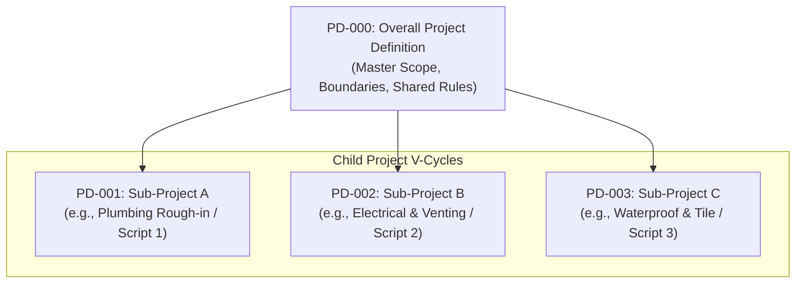
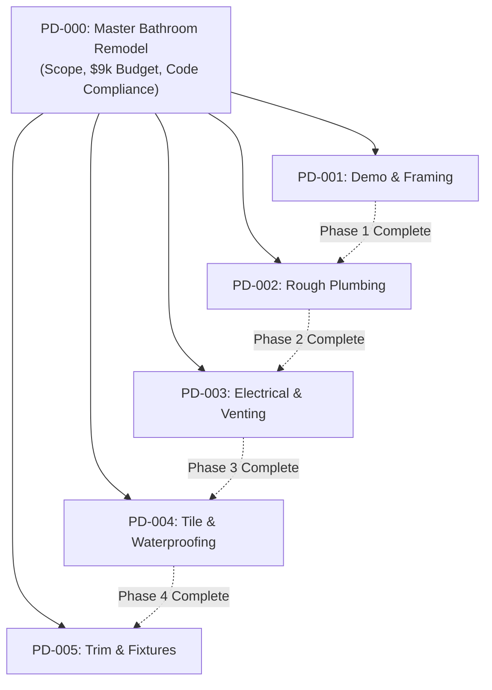

# PD-000: Overall Project Definition

## Overview

The **PD-000** is the root document in the lightweight V-Model. It provides an umbrella view of an entire project before work splits into smaller, focused child projects.

A standard Project Definition (such as `PD-001`) focuses on a single build cycle with one set of goals and acceptance criteria. In contrast, the **PD-000 Overall Project Definition** defines the master vision, global boundaries, shared rules, and sub-project roadmap for an entire initiative.

Use a PD-000 when an effort is too broad, complex, or open-ended to fit inside a single V-cycle.

---

## When to Use a PD-000

Not every build needs a PD-000. If you are building a standalone temperature monitor or a single 3D-printed bracket, start directly with a standard Project Definition (`PD-001`).

Create a PD-000 when your work falls into one of two major patterns:

### Pattern 1: Open-Ended Tool Collections
These projects have no fixed end date. They act as an ongoing workbench or library hosting a series of small, independent tools or scripts.

- **Examples:**
  - An Onshape FeatureScript library for custom CAD features.
  - A collection of Home Assistant automation scripts.
  - A shared Arduino/ESP32 sensor utility library.
  - A set of 3D printer tuning and calibration jigs.
- **The Role of PD-000:** It sets the shared folder structure, coding or modeling conventions, quality checks, and instructions for adding new child tools (`PD-001`, `PD-002`).

### Pattern 2: Large Multi-Phase Projects
These projects have one large goal, but the effort is too complex to design, build, and test in one pass. Trying to run a single V-cycle for the entire job leads to confusion and stalled progress.

- **Examples:**
  - Remodeling a bathroom.
  - Building an off-grid solar generator cart.
  - Restoring a vintage motorcycle.
  - Building an automated hydroponic greenhouse.
- **The Role of PD-000:** It sets the master vision, overall budget, physical room boundaries, shared utilities, and the sequence of smaller phases (`PD-001: Demo & Framing`, `PD-002: Rough Plumbing`, `PD-003: Electrical`).

---

## Core Elements of a PD-000

A clear PD-000 document answers the big-picture questions and leaves detailed engineering to the child projects.

| Section | What It Covers | Why It Matters |
| --- | --- | --- |
| **Project Vision & Intent** | The "North Star" of the endeavor: why this project exists and what success looks like overall. | Keeps the big picture in sight when buried in small technical details. |
| **Global Scope & Boundaries** | What is in scope for the overall project, and what is strictly out of scope. | Stops project creep across all sub-projects. |
| **Shared Environment & Context** | The physical room, CAD ecosystem (e.g., Onshape), vehicle chassis, or code repository where work happens. | Ensures all child projects fit the same physical or digital space. |
| **Global Constraints & Guardrails** | Overarching budget ceilings, safety rules (mains voltage, permits, structural walls), and deadlines. | Sets non-negotiable boundaries that every child project must obey. |
| **Sub-Project Roadmap** | The list or sequence of child projects (`PD-001`, `PD-002`, etc.) and dependencies between them. | Breaks a massive mountain of work into achievable, testable steps. |
| **Shared Standards & Conventions** | Common rules inherited by all sub-projects: naming conventions, unit systems (metric vs. imperial), wire color codes, or git workflows. | Keeps parts compatible and eliminates confusing variations. |
| **Master Goals Review** | How you evaluate overall project success across all completed phases. | Confirms that all child projects combine into a working whole. |

---

## Two Examples in Action

### Example A: Onshape FeatureScript Collection (Open-Ended)

In an Onshape FeatureScript project, a designer builds custom CAD features over months or years. The PD-000 coordinates the repository:

- **Vision:** Create a reliable suite of parametric CAD feature scripts to speed up 3D print design in Onshape.
- **Shared Context:** A single Onshape public document or linked repository using the standard FeatureScript API.
- **Global Standards:**
  - All scripts use metric default units with internal millimeter conversions.
  - Every script must include clear input parameter tooltips and icon graphics.
  - Code must pass automated syntax checks and include a test Part Studio.
- **Child Projects:**
  - `PD-001`: Parametric Snap-Fit Joint Generator
  - `PD-002`: O-Ring Groove Cutter
  - `PD-003`: Hex Pattern Weight Reducer

Each child script runs through its own small V-cycle: define parameters, write script, test geometry on the CAD canvas, and release.

### Example B: Master Bathroom Remodel (Multi-Phase)

A full bathroom remodel is too large for one test pass. The PD-000 sets the boundaries for the room:

- **Vision:** Transform a dated, leaking master bathroom into a modern, moisture-resistant, energy-efficient space.
- **Global Boundaries:** Confined to the existing 8 ft $\times$ 10 ft footprint; existing load-bearing walls cannot be moved.
- **Global Constraints:** Total budget cap of \$9,000; all plumbing and electrical must meet local building safety codes; work must keep the house main water supply on overnight.
- **Sub-Project Roadmap:**
  - `PD-001`: Demolition, Subfloor Inspection, and Framing Repairs
  - `PD-002`: Rough-in Plumbing and Shower Pan Water Test
  - `PD-003`: Electrical Rough-in, GFCI Circuits, and Exhaust Venting
  - `PD-004`: Wall Board, Waterproofing Membrane, and Tile
  - `PD-005`: Fixture Trim, Vanity Install, and Final Inspection

Each phase has its own start criteria and verified exit review before the next phase begins.

---

## Traceability and Hierarchy

The PD-000 establishes a clean parent-child hierarchy in your project documentation:

1. **Root Document:** `PD-000` is the root ancestor. It has no parent document above it.
2. **Child Document Inheritance:** Every child Project Definition (`PD-001`, `PD-002`) cites `PD-000` as its parent.
3. **Constraint Propagation:** A child project inherits all global limits from `PD-000`. For example, if `PD-000` sets an overall project budget of \$9,000, child projects cannot exceed their portion of that cap without updating `PD-000`.
4. **Independent Lifecycle:** Each child project moves through its own V-cycle levels (Architecture, Components, Build, and Review) at its own pace.

---

## Common Pitfalls

| Pitfall | Problem | Solution |
| --- | --- | --- |
| **Writing technical code in PD-000** | Fills the master document with low-level details that become obsolete quickly. | Keep PD-000 focused on scope, boundaries, and roadmap. Move technical details into child projects. |
| **Skipping PD-000 on complex builds** | Builders dive into details, lose track of budget or scope, and end up with incompatible subsystems. | Take 30 minutes to draft PD-000 before starting multi-phase builds. |
| **Overusing PD-000 on simple builds** | Creates unnecessary paperwork for a quick weekend build that only needs one simple document. | If a project can be designed, built, and tested in one continuous flow, start directly with `PD-001`. |
| **Letting child projects drift** | Sub-projects invent their own incompatible parts or exceed the master budget. | Check every child Project Definition against the PD-000 guardrails before building. |

