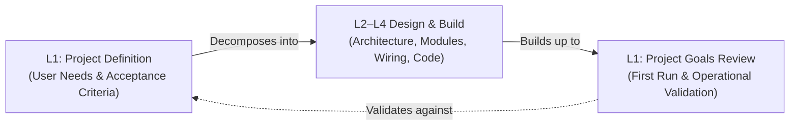

# Project Definition & Project Goals Review

## Overview

The **Project Definition** and the **Project Goals Review** form Level 1 (L1) of the lightweight V-Model.

- The **Project Definition** (left side of the V) defines user needs, project boundaries, and clear success criteria before design starts.
- The **Project Goals Review** (right side of the V) tests the finished build in its real operating environment. This step is also called the First Run or Operational Validation. It proves that the finished build achieves the project goals.

Every lower design step (Architecture, Components, and Code) traces directly back to Level 1. Setting clear boundaries early prevents scope creep and ensures you build the right thing.

## At a Glance

| Aspect | Project Definition (Left Side) | Project Goals Review (Right Side) |
| --- | --- | --- |
| **Core Question** | What problem does the project solve, and why? | Does the finished build solve that problem in daily use? |
| **Perspective** | User and builder expectations for the complete build | User and builder test of the working build |
| **Primary Users** | The builder, household members, or target users | Same |
| **Conducted By** | Project builder or team lead before design starts | Project builder and users testing the working build |
| **Environment** | Project notes, notebook, or repository docs | Real operating setting (home, workshop, or field) |

---

## Part 1: Project Definition (Left Side)

### Purpose

The Project Definition sets the scope and boundaries for the project. It describes what the project must do without picking internal parts. A clear Project Definition prevents feature creep and gives you a clear checklist for final testing.

### What Belongs in the Project Definition

| Section | Purpose and Guidance |
| --- | --- |
| **Problem Statement** | Describe the current problem, who has it, and why solving it matters. Write from the user view. |
| **Target Users & Context** | Identify who will use the build (e.g., family members or workshop users) and where it will run. |
| **User Scenarios** | Short stories of normal use (e.g., "When indoor rooms get warmer than outside air in the evening, the system prompts the user to open windows"). Include failure cases like power loss or network drops. |
| **Acceptance Criteria** | Concrete, observable outcomes that define success. The Project Goals Review tests these directly. |
| **Physical Setup & Care** | Practical setup needs: mounting, power access, battery life goals, weather shelter, and service intervals. |
| **Safety Needs** | Hazards like wall power (120V/240V), high current, battery charging, moving parts, or water. List these early to plan safe boxes and wiring. |
| **Scope & Limits** | State clearly what the current build will *not* do to stop scope creep. |
| **Validation Plan** | Outline the test plan: where to place units, how long to test, and what counts as a pass. |
| **External Needs** | Outside systems needed for success: home Wi-Fi, smart-home hubs (HomeKit, Home Assistant), cloud feeds, or parts. |

### What Does Not Belong Here

Keep low-level build details out of Level 1:
- **No specific hardware parts**: Do not list pinouts, circuit boards, or chip models (these belong in L2 Architecture and L3 Component Definition).
- **No low-level protocols or data schemas**: Leave out MQTT topic paths, JSON layouts, or chip registers (these belong in L2 Architecture and L4 Technical Definition).
- **No software algorithms**: Do not write code loops, math formulas, or state machine charts (these belong in L4 Functional Definition).

> If design ideas pop up while writing the Project Definition, note them in an "Early Technical Notes" section for the Architecture phase, then return to user needs.

### Writing Good Acceptance Criteria

Acceptance criteria must be **observable** by the user without special lab tools and **measurable** so that two people can agree on pass or fail.

| Weak Criteria | Strong Criteria |
| --- | --- |
| "The sensor should read temperature quickly." | "Sensor readings update on the user screen within 10 seconds of a room temperature change." |
| "The device should be reliable." | "The system runs for 14 days in place without freezing, rebooting, or needing a power reset." |
| "Battery life should be good." | "The outdoor sensor node runs for at least 6 months on one 18650 cell before needing a recharge." |
| "Alert the user when it gets hot." | "The system sends an alert to the user phone within 2 minutes of outdoor air dropping 2 °C below indoor air." |
| "The box must survive outside." | "The outdoor case keeps out rain (IP65 rated or shielded) and runs from -10 °C to 45 °C." |

### Example: Home Temperature Monitor

> **Project Definition: Home Temperature Monitor (`PRJ-TEMP`)**
>
> **Problem Statement:**
> During warm months, our house traps heat upstairs after outdoor air cools in the evening. Household members cannot tell when outdoor air is cooler than indoor rooms. This leads to late window opening, hot rooms, and wasted air conditioning.
>
> **Target Users:**
> Household members who manage home comfort and open windows for cooling.
>
> **User Scenarios:**
> - *Daily Monitoring:* Occupants check a phone screen or home dashboard to see indoor and outdoor temperatures.
> - *Cool-down Prompt:* When outside air cools below indoor air, the system alerts occupants to open windows and turn on fans.
> - *Network Drop Handling:* If an outdoor sensor loses power or drops Wi-Fi, the screen marks the sensor offline instead of showing old data.
>
> **Acceptance Criteria:**
> 1. Indoor and outdoor temperatures show in Apple HomeKit / Home Assistant and update at least once every 60 seconds.
> 2. Temperature readings stay accurate within $\pm 0.5$ °C from -10 °C to 45 °C against a trusted thermometer.
> 3. A phone notification arrives within 2 minutes when outdoor air drops 2 °C below upstairs room air (when indoor is $> 22$ °C).
> 4. The outdoor sensor node runs on battery power for at least 6 months without service.
> 5. If a sensor node disconnects for more than 5 minutes, the screen marks it as offline.
>
> **Out of Scope:**
> - Motorized window openers (manual opening only for this build).
> - Direct thermostat or furnace wiring.
>
> **Validation Plan:**
> Put one indoor node and one outdoor node in place for 14 days. Confirm reading accuracy, battery life, and alert timing during real home use.

---

## Part 2: Project Goals Review (Right Side)

### Purpose

The **Project Goals Review** (First Run validation) **validates** the complete project. It proves that the finished build solves the real problem in daily use under real conditions for a set test period.

Validation is different from verification:
- **Verification (L2–L4):** Proves that the build matches technical plans on the test bench ("Did we build it right?").
- **Validation (L1):** Proves that the finished device solves user needs in daily life ("Did we build the right thing?").

Do not use the Project Goals Review to find basic wiring or code bugs. Catch those earlier during System Testing (L2). Finding a basic bug here means a lower-level test was missed and must be fixed.

### Operating Environment

- Installed in its real spot (mounted outside, placed in rooms, or mounted on a car or bench).
- Used by normal users during daily routines rather than on a test bench.
- Tracked through normal user screens and simple status logs.

### Entry Criteria

Before starting the Project Goals Review, check off these items:
- [ ] **System Testing (L2) passed:** All parts talk and work together on the bench.
- [ ] **Baseline recorded:** Normal power draw, idle Wi-Fi range, and base readings are noted.
- [ ] **User notes written:** Simple steps and safety notes are written for anyone using the device.
- [ ] **Backup ready:** Working firmware files and config copies are saved so you can restore the device if needed.

### Exit Criteria

The Project Goals Review passes when:
- [ ] All Level 1 acceptance criteria pass for the full test period.
- [ ] No unplanned crashes, watchdog resets, or freeze-ups occur.
- [ ] Battery draw and heat stay within safe planned limits.
- [ ] Users agree that the build solves the original problem.

### What to Monitor

| Metric | Why It Matters |
| --- | --- |
| **Acceptance Criteria** | Check each goal in the Project Definition during daily use. |
| **Crashes and Resets** | Catch brownouts, power spikes, or code lockups. |
| **Device Uptime** | Prove multi-day stability without quiet restarts. |
| **Free Memory** | Catch slow memory leaks in microcontrollers or scripts. |
| **Network Health** | Track Wi-Fi, Bluetooth, or MQTT drops and reconnect times. |
| **Sensible Readings** | Catch frozen values, noise spikes, or drift against real conditions. |
| **Power Draw** | Track battery voltage drop under real outdoor temperatures to check life estimates. |

### Test Duration: How Long to Test

The Project Definition sets test length. Pick a duration based on:
- **Day and Night Cycles:** Cover several full 24-hour cycles to test heat peaks, night chill, and sun glare.
- **Infrequent Events:** If an alert needs cool evening air, test until those conditions happen or test them by hand.
- **Slow Failures:** Memory leaks, sensor drift, and timer wrap-arounds often take days to show up.
- **Safety Risk:** Projects using wall power, heating elements, or outdoor weather need longer watch times before being left alone.

### Traceability

- **Parent:** None (Level 1 is the top level).
- **Children:** Decomposes into one or more Level 2 Architecture Definitions.
- **Verified by:** Project Goals Review test logs and user check-off.

---

## Common Pitfalls

| Pitfall | Fix |
| --- | --- |
| **Technical acceptance criteria** (e.g., "Send JSON to topic X") | Rewrite from the user view (e.g., "Screen updates within 10 seconds"). |
| **Vague test duration**, ending tests when you get bored | Pick the test duration in the Project Definition before building. |
| **Surprising users at the end**, building the wrong thing | Talk with users early to make sure the project fits their needs. |
| **No baseline data**, making it hard to tell if readings are normal | Record base readings on the bench before field setup. |
| **Untested recovery steps**, risking a dead unit after an update | Test firmware backups on the bench before outdoor mounting. |

### Example Test Record

| Field | Record Details |
| --- | --- |
| **Verifies** | Project Definition: Home Temperature Monitor (`PRJ-TEMP`), Criteria 1–5 |
| **Units / Location** | Node 01 (North patio outdoor box); Node 02 (Upstairs hall) |
| **Firmware / Software** | Node Code `v1.0.2` (ESP32-C3); Home Assistant Addon `v0.4.0` |
| **Test Period** | 14 days (June 10 to June 24) |
| **Criteria Results** | - **Criterion 1 (Screen updates):** Pass. 100% of readings updated within 45 seconds. - **Criterion 2 (Accuracy):** Pass. Within $\pm 0.3$ °C of reference thermometer. - **Criterion 3 (Cool-down alert):** Pass. Fired reliably across 9 evening cool-down events. - **Criterion 4 (Battery draw):** Pass. Cell dropped 0.08 V over 14 days, estimating $\approx 7.5$ months of life. - **Criterion 5 (Offline alert):** Pass. Cut power to Node 01; screen showed offline at 5 minutes 12 seconds. |
| **Health** | 0 unplanned reboots; Wi-Fi reconnect under 3 seconds; free heap stable at 142 kB. |
| **Sign-off** | Builder and household users confirmed goals met; approved for permanent mounting. |
