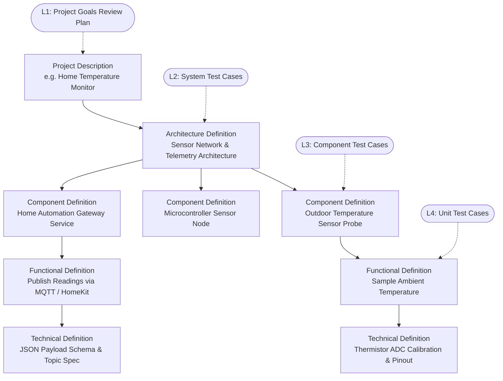

# V-Model for Lightweight Development

## What Is the V-Model?

The V-Model is a **modified waterfall** process. Like waterfall, work flows from high-level definition down to detailed definition, then to implementation. Unlike classic waterfall, **every level of definition has a matching level of testing**, and that test level is planned at the same time the definition is written, not afterward.

Draw the process as a letter V:

- The **left side** goes *down*. Each step **decomposes** the level above it into smaller, more precise pieces. It starts with "what does the project need?" and ends with "what does this function do, bit by bit?"
- The **bottom** is **implementation**, where hardware is assembled, circuits are wired, and code is written.
- The **right side** goes *up*. Each step **integrates and verifies** the pieces, from single functions up to the full project running in its intended operating environment.
- Each **horizontal pair** links a definition to the test that proves it. A test on the right side only checks against the definition directly across from it on the left.

This process keeps development simple: define the goal, break the build into manageable parts, test each layer early, and avoid guessing. A builder can go as deep or as shallow as needed for the size of the project. The process is not meant to micromanage a project; it provides a structured opportunity to gather design requirements in one place and verify that project goals are met.

This is a small-project version of the V-Model. It is designed for hobby builds, DIY projects, or small teams with a clear goal. The point is not paperwork. The point is to reduce mistakes before they cost time, parts, and effort.

## The Levels

| Level | Left Side (Definition) | Right Side (Testing) | Environment | Page |
| --- | --- | --- | --- | --- |
| L1 | **Project Description**: what the project is for, what it must do, and how success is measured | **Project Goals Review**: verify project goals and acceptance criteria in operation (First Run) | Project Environment | [01 Project Description & First Run](Project%20Description%20&%20First%20Run.md) |
| L2 | **Architecture Definition**: how the major parts connect and interact | **System Testing**: verify subsystems work together in a representative setup | Bench / test rig | [02 Architecture Definition & System Testing](Architecture%20Definition%20&%20System%20Testing.md) |
| L3 | **Component Definition**: how each module or subassembly behaves | **Component Testing**: verify each section with proper signals, loads, and test mocks | Bench / lab setup | [03 Component Definition & Component Testing](Component%20Definition%20&%20Component%20Testing.md) |
| L4 | **Functional Definition** (how it works) / **Technical Definition** (pins, registers, schemas, notes) | **Functional / Unit Testing**: quick checks in code or a test jig | Developer workstation, bench toolchain | [04 Functional-Technical Definition & Unit Testing](Functional%20Technical%20Definition%20&%20Unit%20Testing.md) |
| — | **Implementation** | — | Workbench, soldering station, GitHub or notes | [05 Implementation](Implementation.md) |

## Verification vs. Validation

Two terms that sound similar but address distinct quality questions:

- **Verification**: “Did we build it right?” Does the implementation match its technical definition? Levels L2 through L4 focus on verification.
- **Validation**: “Did we build the right thing?” Does the finished project actually solve the user's need in the real world? The L1 Project Goals Review focuses on validation.

A build can pass every unit, component, and system test and still fail validation if the goal was flawed or too vague. For this reason, L1 checks evaluate the build against the actual operating use case, not just the component specs or code.

## Feedback: The V Is Not One-Way

In practice, you will discover problems while working at a lower level. For example, a component test on the bench may reveal that a component definition was ambiguous. When that happens:

- **Fix the definition at the level where the problem was introduced**, not just how the design was implemented.
- If the fix changes a parent definition's intent, update the parent definition and evaluate its impact across related subsystems.
- Re-run tests at every level from the fix upward.

A defect found on the right side is reported against the definition directly across from it. A failed System Test is an Architecture problem until proven otherwise.

## Tailoring: Not Every Change Starts at the Top

Running the full V for a one-line bug fix would be wasteful. A change **enters the V at the highest level it affects** and must still climb back up through every test level above its entry point. Regression suites at the upper levels can be lighter for small changes, but they are not skipped.

| Change Type | Example | Enters at | Must pass |
| --- | --- | --- | --- |
| New project feature | Add an automatic fan mode when temperature rises | L1 Project Description | All levels (L4 Unit, L3 Component, L2 System, and L1 Project Goals Review) |
| Cross-component change with no visible user change | Move a calculation from one microcontroller board to another | L2 Architecture | L4 Unit, L3 Component, and L2 System tests, plus L1 regression check |
| Change confined to one component | Retune a control loop or sensor filter | L3 Component | L4 Unit and L3 Component tests, plus L2 System and L1 smoke checks |
| Change confined to one function | Fix an off-by-one error in a debounce counter | L4 Functional | L4 Unit tests, plus L3 Component regression and L2/L1 smoke checks |
| Calibration value change only | Adjust a threshold constant | L4 Technical (update constant + rationale) | L4 Unit tests, plus targeted L3/L2 sanity checks |

When in doubt, enter one level higher than you think you need.

## Decomposition and Traceability

Each level **fans out** into the next. One Project Description may produce one or more Architecture Definitions. Each of those names several components, and each component owns several functions. Every note or document links to its **parent** (the item it helps satisfy) and its **children** (the items that satisfy it). Every definition also links to the **test cases** that verify it. This keeps the project understandable without turning it into a paperwork project.

**Traceability rules:**

1. Every definition below L1 has exactly one parent at the level above.
2. Every definition has at least one test case at its own level. If you cannot write a test for it, the definition is not precise enough yet.
3. Every test case references the definition it verifies. It does not reference a higher- or lower-level definition.
4. Every pull request or commit references the requirement ID(s) it implements (for example, `REQ-TEMP-01`).

Using these rules, anyone can start from a line of code or a wiring change and trace it back to the project goal it serves. They can also start from the project goal and find the checks that prove it was met.
