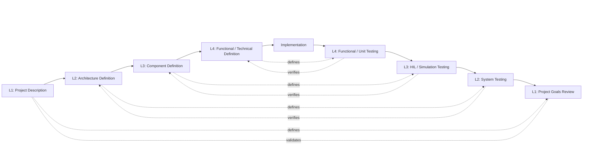
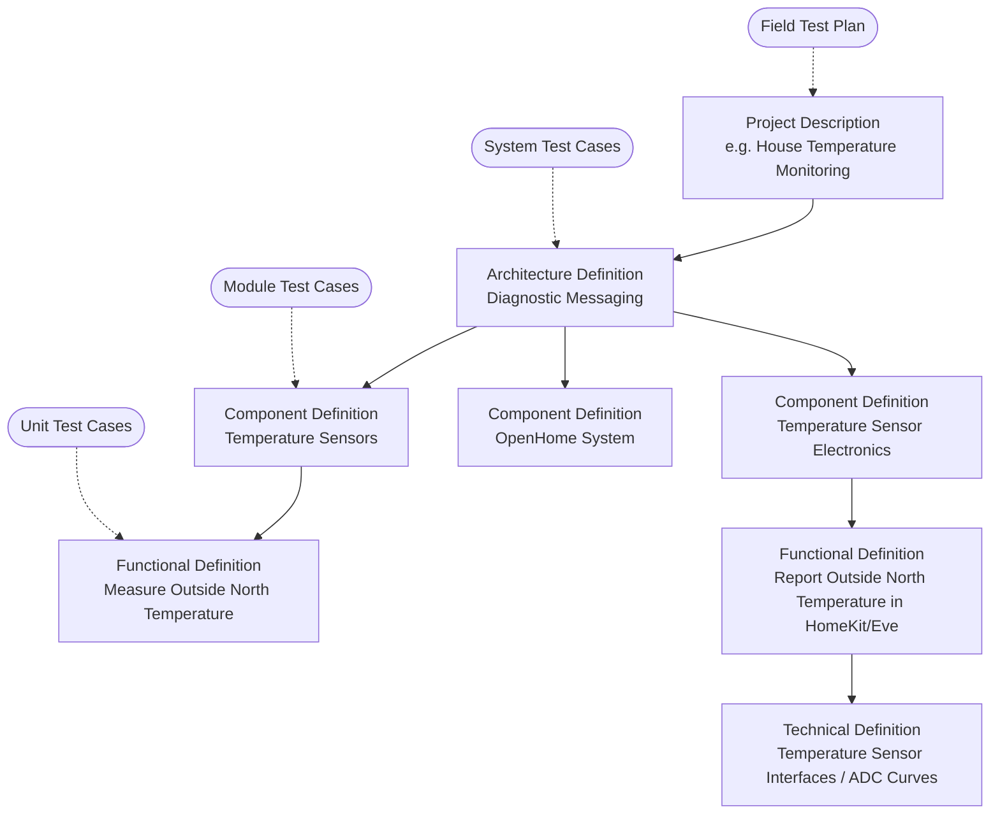

## What Is the V-Model?

The V-Model is a **modified waterfall** process. Like waterfall, work flows from high-level definition down to detailed definition, then to implementation. Unlike classic waterfall, **every level of definition has a matching level of testing**, and that test level is planned at the same time the definition is written, not afterward.

Draw the process as a letter V:

- The **left side** goes *down*. Each step **decomposes** the level above it into smaller, more precise pieces. It starts with “what does the product need?” and ends with “what does this function do, bit by bit?”
- The **bottom** is **implementation**, where code is written.
- The **right side** goes *up*. Each step **integrates and verifies** the pieces, from single functions up to the full product running in production.
- Each **horizontal pair** links a definition to the test that proves it. A test on the right side only checks against the definition directly across from it on the left.

This process is meant to keep things simple: define the goal, break the build into manageable parts, test each layer early, and avoid guessing.  A designer can go as deep or as shallow as needed for the size of the project, this development process is not meant to strictly reign in and micromanage a project, it's more of an opportunity to gather all of your thoughts in one place and be able to say you met your goals.

This is a small-project version of the V-Model. It is meant for a hobby build, a DIY project, or a small team with a clear goal. The point is not paperwork. The point is to reduce mistakes before they cost time, parts, and patience.

## The Levels

| Level | Left Side (Definition) | Right Side (Testing) | Environment | Page |
| --- | --- | --- | --- | --- |
| L1 | **Project Description**: what the project is for, what it must do, and how success is measured | **Project Goals Review**: the project goals are met | Project Enviroment | [01 Project Description & First Run](Project%20Description%20&%20First%20Run.md) |
| L2 | **Architecture Definition**: how the major parts connect and interact | **System Testing**: the subsystems work together in a representative setup | Bench / test rig | [02 Architecture Definition & System Testing](Architecture%20Definition%20&%20System%20Testing.md) |
| L3 | **Component Definition**: how each module or subassembly behaves | **Module Testing**: each section is checked with the right signals and loads | Bench / lab setup | [03 Component Definition & Module Testing](Component%20Definition%20&%20Module%20Testing.md) |
| L4 | **Functional Definition** (how it works) / **Technical Definition** (pins, registers, schemas, notes) | **Functional / Unit Testing**: quick checks in code or a test jig | Developer workstation, bench toolchain | [04 Functional-Technical Definition & Unit Testing](Functional%20Technical%20Definition%20&%20Unit%20Testing.md) |
| — | **Implementation** | — | Workbench, soldering station, GitHub or notes | [05 Implementation](Implementation.md) |

## Verification vs. Validation

Two words that sound the same but mean different things:

- **Verification**: “Did we build it right?” Does the implementation match its definition? Levels L2 through L4 are mostly verification.
- **Validation**: “Did we build the right thing?” Does the change actually solve the project goal in the real world? The L1 project goals review is validation.

A build can pass every module test and still fail validation if the goal was wrong or too vague. That is why L1 checks happen against the actual use case, not just the parts list or code.

## Feedback: The V Is Not One-Way

In practice, you will discover problems while working at a lower level. For example, a HIL test may reveal that the component definition was ambiguous. When that happens:

- **Fix the definition at the level where the problem was introduced**, not just how the design was implemented.
- If the fix changes a parent’s intent, escalate to the parent’s owner.
- Re-run the tests at every level from the fix upward.

A defect found on the right side is reported against the definition directly across from it. A failed System Test is an Architecture problem until proven otherwise.

## Tailoring: Not Every Change Starts at the Top

Running the full V for a one-line bug fix would be wasteful. A change **enters the V at the highest level it affects** and must still climb back up through every test level above its entry point. Regression suites at the upper levels can be lighter for small changes, but they are not skipped.

| Change Type | Example | Enters at | Must pass |
| --- | --- | --- | --- |
| New project feature | Add an automatic fan mode when temperature rises | L1 Project Description | All levels |
| Cross-module change with no visible user change | Move a calculation from one board to another | L2 Architecture | L2 through L4 tests + L1 check |
| Change confined to one module | Retune a control loop or sensor filter | L3 Component | L3 and L4 tests + L2 check + L1 smoke test |
| Change confined to one function | Fix an off-by-one in a debounce counter | L4 Functional | L4 tests + L3 regression + L2/L1 smoke check |
| Calibration value change only | Adjust a threshold | L4 Technical (update constant + rationale) | L4 tests + targeted L3/L2 checks |

When in doubt, enter one level higher than you think you need.

## Decomposition and Traceability

Each level **fans out** into the next. One Project Description may produce one or more Architecture Definitions. Each of those names several modules, and each module owns several functions. Every note or document links to its **parent** (the item it helps satisfy) and its **children** (the items that satisfy it). Every definition also links to the **test checks** that verify it. This keeps the project understandable without turning it into a paperwork project.

**Traceability rules:**

1. Every definition below L1 has exactly one parent at the level above.
2. Every definition has at least one test case at its own level. If you cannot write a test for it, the definition is not precise enough yet.
3. Every test case references the definition it verifies. It does not reference a higher- or lower-level definition.
4. Every pull request references the requirement ID(s) it implements (for example `REQ-421`).

Using these rules, anyone can start from a line of code or a wiring change and trace it back to the project goal it serves. They can also start from the project goal and find the checks that prove it was met.