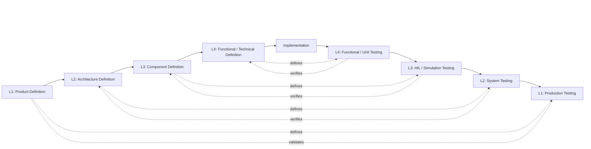
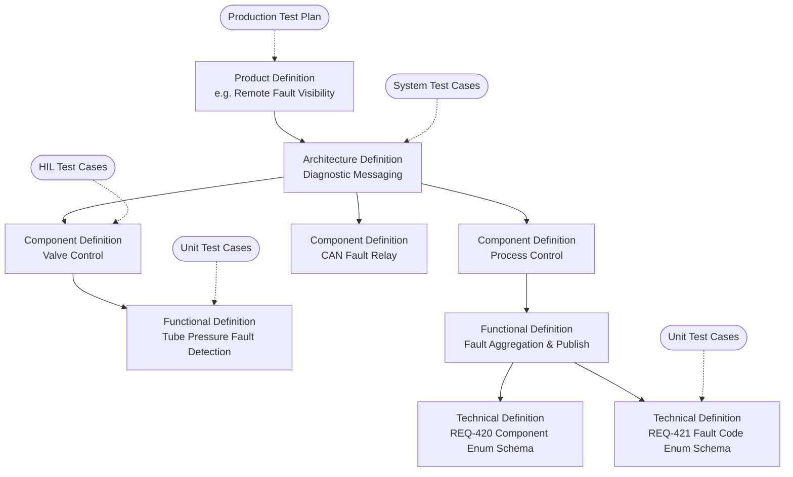

## What Is the V-Cycle?

The V-Cycle is a **modified waterfall** process. Like waterfall, work flows from high-level definition down to detailed definition, then to implementation. Unlike classic waterfall, **every level of definition has a matching level of testing**, and that test level is planned at the same time the definition is written, not afterward.

Draw the process as a letter V:

- The **left side** goes *down*. Each step **decomposes** the level above it into smaller, more precise pieces. It starts with “what does the product need?” and ends with “what does this function do, bit by bit?”
- The **bottom** is **implementation**, where code is written.
- The **right side** goes *up*. Each step **integrates and verifies** the pieces, from single functions up to the full product running in production.
- Each **horizontal pair** links a definition to the test that proves it. A test on the right side only checks against the definition directly across from it on the left.

The key difference is that **firmware runs on physical machines that move, heat, and pressurize things**. There is no instant rollback, no autoscaling, and often no debugger attached. A mistake found in production costs far more than one found in a unit test. It may also be a safety issue, not just a bug. The V-Cycle front-loads definition so that most mistakes are caught on the left side of the V, on paper, where they are cheapest to fix.

### A mental model for full-stack developers

You already work with most of these ideas under different names:

| V-Cycle Level | Definition artifact is like… | Test level is like… |
| --- | --- | --- |
| L1 Product | A PRD / epic with acceptance criteria | Canary release + production monitoring |
| L2 Architecture | A system design doc (services, message flows, contracts) | End-to-end tests in a staging environment |
| L3 Component | A service design doc (one service’s responsibilities and API) | Contract/integration tests of one service with its dependencies mocked |
| L4 Functional / Technical | An API spec, JSON schema, or algorithm spec | Unit tests in CI |
| Implementation | Writing the code and opening the PR | — |

## The Levels

| Level | Left Side (Definition) | Right Side (Testing) | Environment | Page |
| --- | --- | --- | --- | --- |
| L1 | **Product Definition**: how the feature relates to the whole product; customer-facing | **Production Testing**: feature runs on operational production units for a prescribed period | Production fleet | [01 Product Definition & Production Testing](Product%20Definition%20&%20Production%20Testing%203ead2604d1aa801588f0f698f22348e7.md) |
| L2 | **Architecture Definition**: how the feature fits the system; which component groups are touched | **System Testing**: integration between component groups on representative equipment | Engineering / test vessel | [02 Architecture Definition & System Testing](https://app.notion.com/p/Architecture-Definition-System-Testing-3ead2604d1aa805990fbf738148d3f6a?pvs=21) |
| L3 | **Component Definition**: how each component performs its portion | **HIL / Simulation Testing**: single components with simulated IO, often automated | Lab / HIL rig | [03 Component Definition & HIL-Simulation Testing](Component%20Definition%20&%20HIL%20Simulation%20Testing%203ead2604d1aa80d6aea0c7bdf59b6841.md) |
| L4 | **Functional Definition** (how it works) / **Technical Definition** (optional: pins, registers, schemas) | **Functional / Unit Testing**: automated in pipelines | CI pipeline (host and/or target) | [04 Functional-Technical Definition & Unit Testing](Functional%20Technical%20Definition%20&%20Functional%20Unit%20%203ead2604d1aa80f9a6f2fe9f6524953c.md) |
| — | **Implementation** | — | Developer workstation, GitHub | [05 Implementation](Implementation%203ead2604d1aa8059a5aede7ab46f9075.md) |

## Verification vs. Validation

Two words that sound the same but mean different things:

- **Verification**: “Did we build it right?” Does the implementation match its definition? Levels L2 through L4 are mostly verification.
- **Validation**: “Did we build the right thing?” Does the change actually solve the customer’s problem in the real world? Production Testing (L1) is validation.

A feature can pass every verification test and still fail validation, for example if the Product Definition itself was wrong. That is why L1 testing happens on real production units with real users.

## Feedback: The V Is Not One-Way

In practice, you will discover problems while working at a lower level. For example, a HIL test may reveal that the component definition was ambiguous. When that happens:

- **Fix the definition at the level where the problem was introduced**, not just the code.
- If the fix changes a parent’s intent, escalate to the parent’s owner.
- Re-run the tests at every level from the fix upward.

A defect found on the right side is reported against the definition directly across from it. A failed System Test is an Architecture problem until proven otherwise.

## Tailoring: Not Every Change Starts at the Top

Running the full V for a one-line bug fix would be wasteful. A change **enters the V at the highest level it affects** and must still climb back up through every test level above its entry point. Regression suites at the upper levels can be lighter for small changes, but they are not skipped.

| Change Type | Example | Enters at | Must pass |
| --- | --- | --- | --- |
| New customer-visible feature | New maintenance action available from the supervisor | L1 Product | All levels |
| Cross-component change with no customer-visible behavior change | Move a calculation from one processor to another | L2 Architecture | L2 through L4 tests + L1 regression |
| Change confined to one component | Retune a control loop state machine | L3 Component | L3 and L4 tests + L2 regression + L1 soak |
| Change confined to one function | Fix an off-by-one in a debounce counter | L4 Functional | L4 tests + L3 regression + L2/L1 regression |
| Calibration value change only | Adjust a threshold | L4 Technical (update constant + rationale) | L4 tests + targeted L3/L2 checks |

When in doubt, enter one level higher than you think you need.

## Decomposition and Traceability

Each level **fans out** into the next. One Product Definition may produce one or more Architecture Definitions. Each of those names several components, and each component owns several functions. Every document links to its **parent** (the item it helps satisfy) and its **children** (the items that satisfy it). Every definition also links to the **test cases** that verify it.  The Requirements & Specifications archive attempts to enforce this paradigm through heirarchy.

**Traceability rules:**

1. Every definition below L1 has exactly one parent at the level above.
2. Every definition has at least one test case at its own level. If you cannot write a test for it, the definition is not precise enough yet.
3. Every test case references the definition it verifies. It does not reference a higher- or lower-level definition.
4. Every pull request references the requirement ID(s) it implements (for example `REQ-421`).

Using these rules, anyone can start from a line of code and trace it up to the customer need it serves. They can also start from a customer need and find every test that proves it was met.